<picture><source media="(prefers-color-scheme: dark)" srcset="assets/dist/hero-nursing-jobs-dark.svg"><source media="(prefers-color-scheme: light)" srcset="assets/dist/hero-nursing-jobs-light.svg"></picture>

<a href="#open-jobs"><picture><source media="(prefers-color-scheme: dark)" srcset="assets/dist/btn-primary-dark.svg"><source media="(prefers-color-scheme: light)" srcset="assets/dist/btn-primary-light.svg"></picture></a>

<a href="https://chromewebstore.google.com/detail/gmdkffapbfeanfecgcodocfcefldjaho"><picture><source media="(prefers-color-scheme: dark)" srcset="assets/dist/btn-extension-dark.svg"><source media="(prefers-color-scheme: light)" srcset="assets/dist/btn-extension-light.svg"></picture></a>&nbsp;&nbsp;<a href="https://jobhacki.com/login-v2"><picture><source media="(prefers-color-scheme: dark)" srcset="assets/dist/btn-account-dark.svg"><source media="(prefers-color-scheme: light)" srcset="assets/dist/btn-account-light.svg"></picture></a>

Join the JobHacki Discord community to talk about jobs with other job seekers.

<a href="https://discord.gg/RApjXmgnwA">Compare notes on nursing jobs with other job seekers in #leads-health.</a>

**⭐ Star this repo to find the nursing jobs list again easily.**

<table><tr><td align="center" valign="top"><h3>22,935</h3>open nursing jobs in this list (latest refresh)</td><td align="center" valign="top"><h3>150</h3>freshest rows shown below</td><td align="center" valign="top"><h3>2026-11-24</h3>newest posting date</td></tr></table>

Snapshot 2026-11-24 04:18 UTC

**Hi, I'm Sophia, JobHacki's AI assistant. Pick a list, inspect a role, and follow its employer link.**

For RNs, LPNs, NPs, and more, this list is a fresh slice of nursing jobs taken from employers' own hiring systems. Updated Nov 24, 2026.

[Back to all 12 lists](https://github.com/Jobhacki/jobs)

 

<picture><source media="(prefers-color-scheme: dark)" srcset="assets/dist/divider-dark.svg"><source media="(prefers-color-scheme: light)" srcset="assets/dist/divider-light.svg"></picture>

## How to use this list

1. Scan the table for nursing roles that match your license and preferred setting.
2. Check the posting date and confirm license and location requirements on the employer's page.
3. Open the employer's apply link to review the role and apply.
4. If useful, try the Chrome extension, free account, or Discord as optional extras.
5. Report a dead link or suggest a nursing job using [CONTRIBUTING.md](CONTRIBUTING.md) and issues.

## Open jobs

**22,935 open nursing jobs seen in the latest refresh.** The table shows the freshest 150. **Last updated: 2026-11-24 04:18 UTC.** Apply links go to the employer's career page or hiring system.

<!-- JOBS_TABLE_START -->
| Role | Employer | Location | Pay | Posted | Apply |
|---|---|---|---|---|---|
| Licensed Vocational Nurse/LPT | Inc | Palmdale, CA, US |  | 2026-11-24 | [Apply](https://workforcenow.adp.com/mascsr/default/mdf/recruitment/recruitment.html?cid=094a5148-4464-41e3-a172-2b560815bcb6&ccId=19000101_000001&jobId=634928&lang=en_US&source=CC2) |
| Embedded Care Management Nurse or Social Worker | cambiahealth | Bismarck, ND |  | 2026-11-24 | [Apply](https://cambiahealth.wd504.myworkdayjobs.com/en-US/external/job/Bismarck-ND/Embedded-Care-Management-Nurse-or-Social-Worker_R-6933) |
| RN - ICU Weekend Option 7a | bhs | Paducah, KY |  | 2026-11-24 | [Apply](https://bhs.wd1.myworkdayjobs.com/en-US/careers/job/Paducah-KY/RN---ICU-Weekend-Option-7a_R26110247) |
| Registered Nurse (CVOR) | bhs | Lexington, KY |  | 2026-11-24 | [Apply](https://bhs.wd1.myworkdayjobs.com/en-US/careers/job/Lexington-KY/Registered-Nurse--CVOR-_R26110380) |
| Registered Nurse NICU PRN Days | bhs | Louisville, KY |  | 2026-11-24 | [Apply](https://bhs.wd1.myworkdayjobs.com/en-US/careers/job/Louisville-KY/Registered-Nurse-NICU-PRN-Days_R26110126) |
| Nurse Supervisor PD | brownhealth | Rhode Island Hospital |  | 2026-11-24 | [Apply](https://brownhealth.wd12.myworkdayjobs.com/en-US/external_careers/job/Rhode-Island-Hospital/Nurse-Supervisor-PD_JR-116394) |
| Outpatient Registered Nurse - RN | freseniusmedicalcare | Mt Morris, MI |  | 2026-11-24 | [Apply](https://freseniusmedicalcare.wd3.myworkdayjobs.com/en-US/fme/job/Mt-Morris-MI/Outpatient-Registered-Nurse---RN_R0278705) |
| Outpatient Registered Nurse - RN | freseniusmedicalcare | Muskegon, MI |  | 2026-11-24 | [Apply](https://freseniusmedicalcare.wd3.myworkdayjobs.com/en-US/fme/job/Muskegon-MI/Outpatient-Registered-Nurse---RN_R0278295) |
| Licensed Vocational Nurse LVN | CVS Health | TX - Austin |  | 2026-11-24 | [Apply](https://cvshealth.wd1.myworkdayjobs.com/en-US/CVS_Health_Careers/job/TX---Austin/Licensed-Vocational-Nurse-LVN_R1113298) |
| Stroke Nurse Practitioner (NP) or Physician Assistant (PA)-PRN | Munson Healthcare | Traverse City, Michigan, US |  | 2026-11-24 | [Apply](https://jobs.smartrecruiters.com/MunsonHealthcare1/3743990017050376) |
| Urology Nurse Practitioner (NP) or Physician Assistant (PA) | Munson Healthcare | Gaylord, Michigan, US |  | 2026-11-24 | [Apply](https://jobs.smartrecruiters.com/MunsonHealthcare1/3743990017050416) |
| Contract Enrollment Nurse | Virta Health | Remote |  | 2026-11-24 | [Apply](https://jobs.ashbyhq.com/virtahealth/80c11f02-5f7a-49e6-b866-d72efbe6e5f3) |
| LPN – Skilled Nursing | uvmhealth | Malone, NY |  | 2026-11-24 | [Apply](https://uvmhealth.wd1.myworkdayjobs.com/en-US/ahmc/job/Malone-NY/LPN---Skilled-Nursing_R0092060) |
| CNA - Skilled Nursing | uvmhealth | Malone, NY |  | 2026-11-24 | [Apply](https://uvmhealth.wd1.myworkdayjobs.com/en-US/ahmc/job/Malone-NY/CNA---Skilled-Nursing_R0090025) |
| Public Health Nurse Practitioner - Full-Time OR Part-Time | weldgov | Greeley, CO |  | 2026-11-24 | [Apply](https://weldgov.wd5.myworkdayjobs.com/en-US/weldcountycareers/job/Greeley-CO/Public-Health-Nurse-Practitioner---Full-Time-OR-Part-Time_JR102800-1) |
| RN Case Manager | bcbsmn | Eagan, MN |  | 2026-11-24 | [Apply](https://bcbsmn.wd5.myworkdayjobs.com/en-US/bluecrossmn/job/Eagan-MN/RN-Case-Manager_R0006880-1) |
| Licensed Practical Nurse (LPN) | aspendental | Catskill, New York |  | 2026-11-24 | [Apply](https://aspendental.wd1.myworkdayjobs.com/en-US/wellnowurgentcarecareers/job/Catskill-New-York/Licensed-Practical-Nurse--LPN-_R2026-014485) |
| Registered Nurse - Pulmonary - Part Time - Third Shift | valleyhealthlink | Winchester, VA |  | 2026-11-24 | [Apply](https://valleyhealthlink.wd115.myworkdayjobs.com/en-US/valleyhealthcareers/job/Winchester-VA/Registered-Nurse---Pulmonary---Part-Time---Third-Shift_JR110038) |
| Registered Nurse - Operating Room-FT | gmh | Main Grady Campus (Downtown Atlanta) |  | 2026-11-24 | [Apply](https://gmh.wd12.myworkdayjobs.com/en-US/external_careers/job/Main-Grady-Campus-Downtown-Atlanta/Registered-Nurse---Operating-Room-FT_R26005471) |
| Registered Nurse - Operating Room- Various Shift | gmh | Main Grady Campus (Downtown Atlanta) |  | 2026-11-24 | [Apply](https://gmh.wd12.myworkdayjobs.com/en-US/external_careers/job/Main-Grady-Campus-Downtown-Atlanta/Registered-Nurse--Operating-Room--various-shifts-to-include-call--weekends-and-Holidays_R26003526-1) |
| Registered Nurse- Operating Room- various shifts to include call, weekends and... | gmh | Main Grady Campus (Downtown Atlanta) |  | 2026-11-24 | [Apply](https://gmh.wd12.myworkdayjobs.com/en-US/external_careers/job/Main-Grady-Campus-Downtown-Atlanta/Registered-Nurse--Operating-Room--various-shifts-to-include-call--weekends-and-Holidays_R26003013) |
| RN Operating Room | honorhealth |  |  | 2026-11-24 | [Apply](https://honorhealth.wd12.myworkdayjobs.com/en-US/honorhealth_careers/job/Piper-Surgery-Center---9007-E-Shea-Blvd-Scottsdale-AZ-85260/RN-Operating-Room_JR13220) |
| RN Med/Surg 1OBS/2W- New Grads May Apply | honorhealth |  |  | 2026-11-24 | [Apply](https://honorhealth.wd12.myworkdayjobs.com/en-US/honorhealth_careers/job/Osborn-Medical-Center---7400-E-Osborn-Rd-Scottsdale-AZ-85251/RN-Med-Surg-1OBS-2W--New-Grads-May-Apply_JR12870) |
| RN PreOp/PACU, PDs- Network Float Pool | honorhealth |  |  | 2026-11-24 | [Apply](https://honorhealth.wd12.myworkdayjobs.com/en-US/honorhealth_careers/job/Various-Locations--Phoenix-AZ/RN-PreOp-PACU--PDs--Network-Float-Pool_JR13492-1) |
| RN - Progressive Care - CNRVMC - Nights | carilionclinic | Christiansburg, Virginia |  | 2026-11-24 | [Apply](https://carilionclinic.wd12.myworkdayjobs.com/en-US/external_careers/job/Christiansburg-Virginia/RN---Progressive-Care---CNRVMC---Nights_R163600) |
| Associate Director RN Observation Unit | bannerhealth | BUMC Phoenix (1111 E McDowell Rd) |  | 2026-11-24 | [Apply](https://bannerhealth.wd108.myworkdayjobs.com/en-US/careers/job/BUMC-Phoenix-1111-E-McDowell-Rd/Associate-Director-RN-Observation-Unit_R4460433) |
| Registered Nurse (RN) - Emergency Department (ED) - West Hospital | easyservice | Cincinnati, OH |  | 2026-11-24 | [Apply](https://easyservice.wd5.myworkdayjobs.com/en-US/mercyhealthcareers/job/Cincinnati-OH/Registered-Nurse--RN----Emergency-Department--ED----West-Hospital_R293154) |
| Registered Nurse (RN) - Post Anesthesia Care Unit (PACU) - Tiffin Hospital | easyservice | Tiffin, OH |  | 2026-11-24 | [Apply](https://easyservice.wd5.myworkdayjobs.com/en-US/mercyhealthcareers/job/Tiffin-OH/Registered-Nurse--RN----Post-Anesthesia-Care-Unit--PACU----Tiffin-Hospital_R290970) |
| Registered Nurse - Main PACU - Anderson Hospital | easyservice | Cincinnati, OH |  | 2026-11-24 | [Apply](https://easyservice.wd5.myworkdayjobs.com/en-US/mercyhealthcareers/job/Cincinnati-OH/Registered-Nurse---Main-PACU---Anderson-Hospital_R293138) |
| RN | freseniusmedicalcare | Baltimore, MD, USA |  | 2026-11-24 | [Apply](https://freseniusmedicalcare.wd3.myworkdayjobs.com/en-US/fme/job/Baltimore-MD-USA/RN_R0277439) |
| RN Care Manager, Ambulatory | Sanford Health | MI, Marquette |  | 2026-11-24 | [Apply](https://sanford.wd5.myworkdayjobs.com/en-US/SanfordHealth/job/MI-Marquette/RN-Care-Manager--Ambulatory_R-0280059) |
| LPN - Part Time (Straight Nights, Straight Weekends) | Sanford Health | IA, Ottumwa |  | 2026-11-24 | [Apply](https://sanford.wd5.myworkdayjobs.com/en-US/SanfordHealth/job/IA-Ottumwa/LPN---Part-Time--Straight-Nights--Straight-Weekends-_R-0282653) |
| RN - Registered Nurse - 69th & Louise Children's Clinic - FT Days | Sanford Health | SD, Sioux Falls |  | 2026-11-24 | [Apply](https://sanford.wd5.myworkdayjobs.com/en-US/SanfordHealth/job/SD-Sioux-Falls/RN---Registered-Nurse---69th---Louise-Children-s-Clinic---FT-Days_R-0281744) |
| In-Home Nurse Practitioner or Physician Assistant - Full Time - Allentown PA | CVS Health | PA - Allentown |  | 2026-11-24 | [Apply](https://cvshealth.wd1.myworkdayjobs.com/en-US/CVS_Health_Careers/job/PA---Allentown/In-Home-Nurse-Practitioner-or-Physician-Assistant---Full-Time---Allentown-PA_R1109310) |
| In-Home Nurse Practitioner or Physician Assistant - Part Time - Philadelphia PA | CVS Health | PA - Philadelphia |  | 2026-11-24 | [Apply](https://cvshealth.wd1.myworkdayjobs.com/en-US/CVS_Health_Careers/job/PA---Philadelphia/In-Home-Nurse-Practitioner-or-Physician-Assistant---Part-Time---Philadelphia-PA_R1109256) |
| Registered Nurse (RN) Clinical Quality Analyst | Avera Health | Sioux Falls, SD |  | 2026-11-24 | [Apply](https://avera.wd5.myworkdayjobs.com/en-US/avera-careers/job/Sioux-Falls-SD/Registered-Nurse--RN--Clinical-Quality-Analyst_R-260026593) |
| OB RN | Avera Health | Cresco, IA |  | 2026-11-24 | [Apply](https://avera.wd5.myworkdayjobs.com/en-US/avera-careers/job/Cresco-IA/OB-RN_R-260032075-1) |
| Project Specialist OR Registered Nurse Coordinator (RN) | Avera Health | 5 Locations |  | 2026-11-24 | [Apply](https://avera.wd5.myworkdayjobs.com/en-US/avera-careers/job/Pierre-SD/Project-Specialist-OR-Registered-Nurse-Coordinator--RN-_R-260030343-1) |
| Coord-Periop RN-Informatic Bus | Jefferson Health | Philadelphia, PA |  | 2026-11-24 | [Apply](https://jeffersonhealth.wd5.myworkdayjobs.com/en-US/ThomasJeffersonExternal/job/Philadelphia-PA/Coord-Periop-RN-Informatic-Bus_REQ-0039607-1) |
| Registered Nurse - Emergency Trauma Center (FT - Night) - Jefferson Abington | Jefferson Health | Montgomery County, PA |  | 2026-11-24 | [Apply](https://jeffersonhealth.wd5.myworkdayjobs.com/en-US/ThomasJeffersonExternal/job/Montgomery-County-PA/Registered-Nurse---Emergency-Trauma-Center--FT---Night----Jefferson-Abington_REQ-0039830-1) |
| Registered Nurse - Emergency Trauma Center (FT - Night) - Jefferson Abington | Jefferson Health | Montgomery County, PA |  | 2026-11-24 | [Apply](https://jeffersonhealth.wd5.myworkdayjobs.com/en-US/ThomasJeffersonExternal/job/Montgomery-County-PA/Registered-Nurse---Emergency-Trauma-Center--FT---Night----Jefferson-Abington_REQ-0039829-1) |
| RN Ambulatory - Cardiac Rehab and Prevention | Munson Healthcare | Traverse City, Michigan, US |  | 2026-11-24 | [Apply](https://jobs.smartrecruiters.com/MunsonHealthcare1/3743990017049681) |
| Nurse Practitioner-Medical | BAART Programs | Effingham, NH, United States |  | 2026-11-23 | [Apply](https://jobs.jobvite.com/baart-programs/job/o8p7AfwY) |
| Surgical Physician Assistant/Nurse Practitioner | CLEAR CHOICE DERMATOLOGY LLC | Hillsboro, OR |  | 2026-11-23 | [Apply](https://recruiting.paylocity.com/Recruiting/Jobs/Details/4681817) |
| RN, Registered Nurse Hospice | vitalcaringgroup | Houston, Texas, United States |  | 2026-11-23 | [Apply](https://job-boards.greenhouse.io/vitalcaringgroup/jobs/4517397009) |
| Registered Nurse (Outpatient Surgery Center) | springfertility | Sunnyvale, CA |  | 2026-11-23 | [Apply](https://job-boards.greenhouse.io/springfertility/jobs/4758187005) |
| Nurse Practitioner or Physicians Assistant | metroveincenters | Dearborn, MI |  | 2026-11-23 | [Apply](https://job-boards.greenhouse.io/metroveincenters/jobs/4519662009) |
| Chief Nursing Officer / Director of Nursing RN | Ignite Medical Resorts | Charlotte, NC |  | 2026-11-23 | [Apply](https://recruiting.paylocity.com/Recruiting/Jobs/Details/4685724) |
| Licensed Practical Nurse / Registered Nurse | Ignite Medical Resorts | Blue Springs, MO |  | 2026-11-23 | [Apply](https://recruiting.paylocity.com/Recruiting/Jobs/Details/4686246) |
| Certified Medication Technician | Ignite Medical Resorts | Kansas City, MO |  | 2026-11-23 | [Apply](https://recruiting.paylocity.com/Recruiting/Jobs/Details/4686308) |
| Emergency Department RN - Part-time, Days | Grace Cottage Family Health & Hospital | Townshend, VT |  | 2026-11-23 | [Apply](https://recruiting.paylocity.com/Recruiting/Jobs/Details/4685139) |
| Emergency Department RN - Part-time, Nights | Grace Cottage Family Health & Hospital | Townshend, VT |  | 2026-11-23 | [Apply](https://recruiting.paylocity.com/Recruiting/Jobs/Details/4685428) |
| Certified Nurse Midwife (CNM) | Advantia Health | Frederick, MD |  | 2026-11-23 | [Apply](https://advantia-health.breezy.hr/p/cdc8322ead68-certified-nurse-midwife-cnm) |
| RN, Registered Nurse Home Health | vitalcaringgroup | Gautier, Mississippi, United States |  | 2026-11-23 | [Apply](https://job-boards.greenhouse.io/vitalcaringgroup/jobs/4515346009) |
| Nurse Practitioner/Physician Assistant: Post-Acute & SNF (Full -Time) | theoriamedical | Topeka, KS |  | 2026-11-23 | [Apply](https://job-boards.greenhouse.io/theoriamedical/jobs/5491540008?gh_jid=5491540008) |
| Nurse Practitioner/Physician Assistant: Post-Acute & SNF (Full -Time) | theoriamedical | Chanute, KS |  | 2026-11-23 | [Apply](https://job-boards.greenhouse.io/theoriamedical/jobs/5491520008?gh_jid=5491520008) |
| Registered Nurse-Emergency Department Part Time Nights | Northwestern Memorial Healthcare | Woodstock, IL, US |  | 2026-11-23 | [Apply](https://jobs.smartrecruiters.com/NorthwesternMedicine/744000163326589) |
| Nursing Manager of Operations-Float Pool | Northwestern Memorial Healthcare | Palos Heights, IL, US |  | 2026-11-23 | [Apply](https://jobs.smartrecruiters.com/NorthwesternMedicine/744000163328569) |
| Wellness Resource Nurse | mathersplendido | Splendido (Tucson, AZ) |  | 2026-11-23 | [Apply](https://job-boards.greenhouse.io/mathersplendido/jobs/5307411007) |
| Registered Nurse Neighborhood Manager $100,000 - $106,000 Annually | ChristianLivingCommunities | Centennial, CO, US |  | 2026-11-23 | [Apply](https://jobs.smartrecruiters.com/ChristianLivingCommunities/744000163329495) |
| Registered Nurse (RN) (Part Time, 7a-3p) | connectionshealthsolutions | San Francisco, California, United States |  | 2026-11-23 | [Apply](https://job-boards.greenhouse.io/connectionshealthsolutions/jobs/4519732009) |
| Certified Medication Technician (CMT) / Casual Part-Time /2:45pm - 11:15pm /32... | bethesdahealthgroup | Bethesda Dilworth |  | 2026-11-23 | [Apply](https://job-boards.greenhouse.io/bethesdahealthgroup/jobs/4519358009) |
| Registered Nurse, Visits | bayada | Kailua Kona, HI 96740 / 19.647689845 / -155.97861935 |  | 2026-11-23 | [Apply](https://jobs.bayada.com/en/jobs?gh_jid=8955908002) |
| Licensed Practical Nurse (LPN) | airsculpt | Charlotte, North Carolina, United States |  | 2026-11-23 | [Apply](https://job-boards.greenhouse.io/airsculpt/jobs/8214458003) |
| Registered Nurse (RN) | airsculpt | Charlotte, North Carolina, United States |  | 2026-11-23 | [Apply](https://job-boards.greenhouse.io/airsculpt/jobs/8214446003) |
| 1099 Telemedicine Nurse Practitioner / Flexible Schedule | allarahealth | Florida |  | 2026-11-23 | [Apply](https://jobs.ashbyhq.com/allarahealth/cc943a86-bc4d-46e8-9126-c31d072e082a) |
| 1099 Telemedicine Nurse Practitioner/ Evenings, Fridays, and/or Weekends | allarahealth | California |  | 2026-11-23 | [Apply](https://jobs.ashbyhq.com/allarahealth/27de9e17-44f2-4308-8f0e-d595693bc6c6) |
| Telehealth Nurse Practitioner / W2 FT | allarahealth | Arizona |  | 2026-11-23 | [Apply](https://jobs.ashbyhq.com/allarahealth/b556c3ac-0653-49dc-887d-71ad7d1d0fb7) |
| Licensed Practical Nurse | PrimeCare Medical, Inc. | Leonardtown, MD |  | 2026-11-23 | [Apply](https://recruiting.paylocity.com/Recruiting/Jobs/Details/4685681) |
| Registered Nurse | PrimeCare Medical, Inc. | Leonardtown, MD |  | 2026-11-23 | [Apply](https://recruiting.paylocity.com/Recruiting/Jobs/Details/4685689) |
| Licensed Practical Nurse | PrimeCare Medical, Inc. | Leonardtown, MD |  | 2026-11-23 | [Apply](https://recruiting.paylocity.com/Recruiting/Jobs/Details/4685697) |
| Registered Nurse - Bronx (Residential Services) | ADAPT Community Network | Bronx, NY |  | 2026-11-23 | [Apply](https://recruiting.paylocity.com/Recruiting/Jobs/Details/4685435) |
| Inpatient Review Nurse (Remote, Must have CA LVN/RN License) | alignmenthealthcare | Anywhere in the U.S. |  | 2026-11-23 | [Apply](https://alignmenthealthcare.wd12.myworkdayjobs.com/en-US/ahc_external/job/Anywhere-in-the-US/Inpatient-Review-Nurse--Remote--Must-have-CA-LVN-RN-License-_R2834) |
| RN Quality Improvement Coordinator (South Carolina) | ourhrconnect | W@H South Carolina |  | 2026-11-23 | [Apply](https://ourhrconnect.wd501.myworkdayjobs.com/en-US/scblues/job/WH-South-Carolina/RN-Quality-Improvement-Coordinator_R1053141) |
| Licensed Vocational Nurse, Utilization Management | altamed | Montebello, CA 90640 |  | 2026-11-23 | [Apply](https://altamed.wd1.myworkdayjobs.com/en-US/careers/job/Montebello-CA-90640/Licensed-Vocational-Nurse--Utilization-Management_JR11304) |
| Registered Nurse (RN) Weekend Field RN / Home Healthcare | christianacare | Millsboro, DE |  | 2026-11-23 | [Apply](https://christianacare.wd5.myworkdayjobs.com/en-US/cchs/job/Millsboro-DE/Registered-Nurse--RN--Weekend-Field-RN---Home-Healthcare_JR94399) |
| Registered Nurse (RN) - Christiana Emergency Department - Part Time Midnights -... | christianacare | Newark, DE |  | 2026-11-23 | [Apply](https://christianacare.wd5.myworkdayjobs.com/en-US/cchs/job/Newark-DE/Registered-Nurse--RN----Christiana-Emergency-Department---Part-Time-Midnights------56-per-pay-_JR94995) |
| Registered Nurse (RN)- Christiana Emergency Department - Midnights -$20,000 Sig... | christianacare | Newark, DE |  | 2026-11-23 | [Apply](https://christianacare.wd5.myworkdayjobs.com/en-US/cchs/job/Newark-DE/Registered-Nurse--RN---Christiana-Emergency-Department---Midnights---20-000-Sign-On_JR94998) |
| Urgent Care Physician Assistant or Nurse Practitioner $13,500 Sign On Bonus | gohealthuc | Norwich - Norwich, CT |  | 2026-11-23 | [Apply](https://gohealthuc.wd12.myworkdayjobs.com/en-US/external/job/Norwich---Norwich-CT/Urgent-Care-Physician-Assistant-or-Nurse-Practitioner---13-500-Sign-On-Bonus_JR113345-1) |
| Infection Control Nurse | nyuhs | Johnson City, NY |  | 2026-11-23 | [Apply](https://nyuhs.wd12.myworkdayjobs.com/en-US/nyuhscareers1/job/Johnson-City-NY/Infection-Control-Nurse_R0000016900) |
| Nurse Practitioner or Physician Assistant | marathonhealth | IN-Terre Haute |  | 2026-11-23 | [Apply](https://marathonhealth.wd501.myworkdayjobs.com/en-US/marathon-health-careers/job/IN-Terre-Haute/APP-in-Terre-Haute--IN_JR109303) |
| Part-Time Family Nurse Practitioner or Physician Assistant- Lexington, KY | marathonhealth | KY-Lexington |  | 2026-11-23 | [Apply](https://marathonhealth.wd501.myworkdayjobs.com/en-US/marathon-health-careers/job/KY-Lexington/Part-Time-Family-Nurse-Practitioner-or-Physician-Assistant--Lexington--KY_JR109331) |
| Summer SOAR Nurse Externship | carilionclinic | Roanoke, Virginia |  | 2026-11-23 | [Apply](https://carilionclinic.wd12.myworkdayjobs.com/en-US/external_careers/job/Roanoke-Virginia/Summer-SOAR-Nurse-Externship_R163737) |
| Charge Nurse - Central Region | nc | Wake County, NC |  | 2026-11-23 | [Apply](https://nc.wd108.myworkdayjobs.com/en-US/nc_careers/job/Wake-County-NC/Charge-Nurse---Central-Region_JR-123101) |
| RN Care Manager- Baraboo | Humana | Baraboo, WI |  | 2026-11-23 | [Apply](https://humana.wd5.myworkdayjobs.com/en-US/Humana_External_Career_Site/job/Baraboo-WI/RN-Care-Manager--Baraboo_R-437853) |
| FCP RN Care Manager | Humana | 7 Locations |  | 2026-11-23 | [Apply](https://humana.wd5.myworkdayjobs.com/en-US/Humana_External_Career_Site/job/Madison-WI/FCP-RN-Care-Manager_R-438180) |
| Full Time Licensed Vocational Nurse, LVN (AM) | silverado | Belmont, California |  | 2026-11-23 | [Apply](https://job-boards.greenhouse.io/silverado/jobs/5307092007) |
| CNA - Weekend Option | TheracareINC | Indianapolis, IN, US |  | 2026-11-23 | [Apply](https://jobs.smartrecruiters.com/TheracareINC/744000163268540) |
| Aesthetic Injector (Nurse Practitioner - Part-Time) | peachy | Austin, TX |  | 2026-11-23 | [Apply](https://boards.greenhouse.io/peachy/jobs/4731711006?gh_jid=4731711006) |
| Physician Assistant or Acute Care-Nurse Practitioner Pre-Op, Full-time Days | Northwestern Memorial Healthcare | Huntley, IL, US |  | 2026-11-23 | [Apply](https://jobs.smartrecruiters.com/NorthwesternMedicine/744000163275859) |
| Hospice Registered Nurse / RN On-Call (7 On/7 Off, 5PM-8AM) | missionhealthcare | Salem, OR |  | 2026-11-23 | [Apply](https://job-boards.greenhouse.io/missionhealthcare/jobs/4512848009) |
| Registered Nurse, PRN Nights | IntuitiveHealth1 | Frisco, TX, US |  | 2026-11-23 | [Apply](https://jobs.smartrecruiters.com/IntuitiveHealth1/3743990017034401) |
| Registered Nurse, FT Nights | IntuitiveHealth1 | Frisco, TX, US |  | 2026-11-23 | [Apply](https://jobs.smartrecruiters.com/IntuitiveHealth1/3743990017034566) |
| Registered Nurse. PRN | IntuitiveHealth1 | Frisco, TX, US |  | 2026-11-23 | [Apply](https://jobs.smartrecruiters.com/IntuitiveHealth1/3743990017034626) |
| Oncology Nurse Navigator | employerdirecthealthcare | Dallas, TX - Hybrid (3x in office/week); New York, NY - Hybrid (3x in... |  | 2026-11-23 | [Apply](https://job-boards.greenhouse.io/employerdirecthealthcare/jobs/5307105007) |
| Registered Nurse, Pre-Op / Post-Op / Operating Room (Part-time) | ecpcareers | Largo, FL |  | 2026-11-23 | [Apply](https://www.eyecare-partners.com/careers/current-job-openings/?gh_jid=8958590002) |
| Hospice Admissions Registered Nurse | croihealth | Norwell, MA |  | 2026-11-23 | [Apply](https://job-boards.greenhouse.io/croihealth/jobs/5492265008) |
| Regional Traveling Registered Nurse | cranialtechnologies | Phoenix, Arizona, United States; Travel Position |  | 2026-11-23 | [Apply](https://job-boards.greenhouse.io/cranialtechnologies/jobs/8958436002) |
| Registered Nurse | cranialtechnologies | Irvine, California, United States |  | 2026-11-23 | [Apply](https://job-boards.greenhouse.io/cranialtechnologies/jobs/8958425002) |
| Lead Family Nurse Practitioner (FNP) - Urgent Care | convenientmd | Sutton, Massachusetts, United States; Worcester, Massachusetts, Unite... |  | 2026-11-23 | [Apply](https://job-boards.greenhouse.io/convenientmd/jobs/5492572008) |
| Registered Nurse (RN) (FT, Front End Days) | connectionshealthsolutions | Tucson, Arizona, United States |  | 2026-11-23 | [Apply](https://job-boards.greenhouse.io/connectionshealthsolutions/jobs/4511039009) |
| Licensed Practical Nurse (LPN) │Full-Time │6:45am - 7:15pm │72hrs/pp | bethesdahealthgroup | Bethesda Dilworth |  | 2026-11-23 | [Apply](https://job-boards.greenhouse.io/bethesdahealthgroup/jobs/4519249009) |
| Licensed Practical Nurse (LPN) /Part-Time /6:45am - 3:15pm /64hrs/pp | bethesdahealthgroup | Bethesda Dilworth |  | 2026-11-23 | [Apply](https://job-boards.greenhouse.io/bethesdahealthgroup/jobs/4519226009) |
| Registered Nurse (RN) - 1:1 Homecare | bayada | Henrico, VA 23238 / 37.607572348 / -77.617371376 |  | 2026-11-23 | [Apply](https://jobs.bayada.com/en/jobs?gh_jid=8959017002) |
| Baylor/Weekend Registered Nurse (RN)- 1:1 Homecare | bayada | Estell Manor, NJ 08319 / 39.374320389 / -74.824453825 |  | 2026-11-23 | [Apply](https://jobs.bayada.com/en/jobs?gh_jid=8958981002) |
| RN Managed Care Coordinator I | ourhrconnect | W@H South Carolina |  | 2026-11-23 | [Apply](https://ourhrconnect.wd501.myworkdayjobs.com/en-US/scblues/job/WH-South-Carolina/RN-Managed-Care-Coordinator-I_R1052147) |
| School Nurse | cai | IN-CLIENT-STATE |  | 2026-11-23 | [Apply](https://cai.wd5.myworkdayjobs.com/en-US/computer_aid/job/IN-CLIENT-STATE/School-Nurse_R9028) |
| LPN | harmonyseniorservices | Waldorf, Maryland |  | 2026-11-23 | [Apply](https://harmonyseniorservices.wd108.myworkdayjobs.com/en-US/harmony_careers/job/Waldorf-Maryland/LPN_JR-005426) |
| LPN | brightli | Trenton, MO |  | 2026-11-23 | [Apply](https://brightli.wd5.myworkdayjobs.com/en-US/brightlitalent/job/Trenton-MO/LPN_R-27169) |
| Nurse Assistant | nyuhs | Walton, NY |  | 2026-11-23 | [Apply](https://nyuhs.wd12.myworkdayjobs.com/en-US/nyuhscareers1/job/Walton-NY/Nurse-Assistant_R0000017498) |
| RN Case Manager | carilionclinic | Roanoke, Virginia |  | 2026-11-23 | [Apply](https://carilionclinic.wd12.myworkdayjobs.com/en-US/external_careers/job/Roanoke-Virginia/RN-Case-Manager_R163720) |
| Registered Nurse or Licensed Practical Nurse | the858emily123program | 41 Perimeter Center East, Suite 250 Dunwoody, GA 30346 |  | 2026-11-23 | [Apply](https://job-boards.greenhouse.io/the858emily123program/jobs/5491962008) |
| Registered Nurse - Skilled Nursing | SeniorLifestyle1 | Gorham, ME, US |  | 2026-11-23 | [Apply](https://jobs.smartrecruiters.com/SeniorLifestyle1/744000163225279) |
| Licensed Practical Nurse (LPN) - Skilled Nursing | SeniorLifestyle1 | Gorham, ME, US |  | 2026-11-23 | [Apply](https://jobs.smartrecruiters.com/SeniorLifestyle1/744000163225284) |
| Assistant Director of Nursing (ADON) | otterbein | North Olmsted, OH |  | 2026-11-23 | [Apply](https://boards.greenhouse.io/otterbein/jobs/8214125003?gh_jid=8214125003) |
| Triage Registered Nurse | optimalcare | Grand Rapids, MI |  | 2026-11-23 | [Apply](https://job-boards.greenhouse.io/optimalcare/jobs/5479523008) |
| Weekend Triage Registered Nurse | luminaryhospice | Columbus, Ohio |  | 2026-11-23 | [Apply](https://job-boards.greenhouse.io/luminaryhospice/jobs/5491972008) |
| RN (P/T) Group Home - Queens | AHRCNYC1 | New York, NY, US |  | 2026-11-23 | [Apply](https://jobs.smartrecruiters.com/AHRCNYC1/744000163252621) |
| Staff Nurse LPN- Evening | hebrewseniorlife | Dedham, MA |  | 2026-11-23 | [Apply](https://hebrewseniorlife.wd501.myworkdayjobs.com/en-US/hebrewseniorlifecareers/job/Dedham-MA/Staff-Nurse-LPN--Evening_R-102293) |
| Staff Nurse LPN | hebrewseniorlife | Roslindale, MA |  | 2026-11-23 | [Apply](https://hebrewseniorlife.wd501.myworkdayjobs.com/en-US/hebrewseniorlifecareers/job/Roslindale-MA/Staff-Nurse-LPN_R-102300) |
| RN, Senior LTSS Service Care Manager - Critical Care, ER, ICU | centene | 27 Locations |  | 2026-11-22 | [Apply](https://centene.wd5.myworkdayjobs.com/en-US/centene_external/job/Houston-Texas77007/Senior-LTSS-Service-Care-Manager-RN_1668086) |
| Nurse Practitioner/ Physician Assistant (SUD) | steadfasthealth | Greensboro, North Carolina |  | 2026-11-22 | [Apply](https://job-boards.greenhouse.io/steadfasthealth/jobs/5491809008) |
| Remote Nurse Practitioner - TX License Required | cadencehealth | Remote |  | 2026-11-22 | [Apply](https://job-boards.greenhouse.io/cadencehealth/jobs/4731472006) |
| Remote Nurse Practitioner - MS License Required | cadencehealth | Remote |  | 2026-11-22 | [Apply](https://job-boards.greenhouse.io/cadencehealth/jobs/4731471006) |
| Remote Nurse Practitioner - NC License Required | cadencehealth | Remote |  | 2026-11-22 | [Apply](https://job-boards.greenhouse.io/cadencehealth/jobs/4731470006) |
| LPN - PRN | AsburyCommunities | Wilmington, DE, US |  | 2026-11-22 | [Apply](https://jobs.smartrecruiters.com/AsburyCommunities/744000163098490) |
| Memory Care Nurse Practitioner - per diem | UVM Health Network | Colchester, VT |  | 2026-11-22 | [Apply](https://uvmhealth.wd1.myworkdayjobs.com/en-US/External/job/Colchester-VT/Memory-Care-Nurse-Practitioner---per-diem_R0092114) |
| Staff Nurse II - Short Stay Unit - Full Time - 8hr - 1100-1900- AM Variable Shi... | Washington Hospital | Fremont, CA, United States |  | 2026-11-21 | [Apply](https://jobs.jobvite.com/washingtonhospital/job/oPO6Afw3) |
| Licensed Practical Nurse - Bronx | ADAPT Community Network | Bronx, NY |  | 2026-11-21 | [Apply](https://recruiting.paylocity.com/Recruiting/Jobs/Details/4684432) |
| Night ICU Nurse (Full Time) Silver Spring, Maryland | Infinisource Consulting Solutions | Silver Spring, MD |  | 2026-11-21 | [Apply](https://recruiting.paylocity.com/Recruiting/Jobs/Details/4662917) |
| Night OR Nurse (Full Time) Silver Spring Maryland | Infinisource Consulting Solutions | Silver Spring, MD |  | 2026-11-21 | [Apply](https://recruiting.paylocity.com/Recruiting/Jobs/Details/4662891) |
| Night OR Nurse (Full Time) Silver Spring Maryland | Infinisource Consulting Solutions | Silver Spring, MD |  | 2026-11-21 | [Apply](https://recruiting.paylocity.com/Recruiting/Jobs/Details/4205057) |
| Licensed Practical Nurse | Valor Healthcare, Inc. | Denton, TX |  | 2026-11-21 | [Apply](https://recruiting.paylocity.com/Recruiting/Jobs/Details/3852357) |
| Registered Nurse - Inpatient Psychiatry | UVM Health Network | Burlington, VT |  | 2026-11-21 | [Apply](https://uvmhealth.wd1.myworkdayjobs.com/en-US/External/job/Burlington-VT/Registered-Nurse---Inpatient-Psychiatry_R0090841-1) |
| Registered Nurse - Ambulatory (Pediatrics Hematology Oncology) | Northwell Health | New Hyde Park, Queens, United States |  | 2026-11-21 | [Apply](https://eppr.fa.us2.oraclecloud.com/hcmUI/CandidateExperience/en/sites/CX_2/job/204147) |
| Registered Nurse - Ambulatory (Pediatrics Cardiology - Part Time) | Northwell Health | Bay Shore, Suffolk, United States |  | 2026-11-21 | [Apply](https://eppr.fa.us2.oraclecloud.com/hcmUI/CandidateExperience/en/sites/CX_2/job/203248) |
| Licensed Vocational Nurse | altamed | Long Beach, CA 90810 |  | 2026-11-21 | [Apply](https://altamed.wd1.myworkdayjobs.com/en-US/careers/job/Long-Beach-CA-90810/Licensed-Vocational-Nurse_JR11319) |
| Registered Nurse, Supervisor | altamed | Compton, CA 90220 |  | 2026-11-21 | [Apply](https://altamed.wd1.myworkdayjobs.com/en-US/careers/job/Compton-CA-90220/Registered-Nurse--Supervisor_JR11318) |
| Senior LTSS Service Care Manager, RN - ER, Critical Care, ICU, Med Surg | centene | 21 Locations |  | 2026-11-21 | [Apply](https://centene.wd5.myworkdayjobs.com/en-US/centene_external/job/Remote-TX/Senior-LTSS-Service-Care-Manager--RN---ER--Critical-Care--ICU--Med-Surg_1668744) |
| UAS Field RN- per diem | alwayscompassionate | Newburgh, NY |  | 2026-11-21 | [Apply](https://alwayscompassionate.wd1.myworkdayjobs.com/en-US/achomecare/job/Newburgh-NY/UAS-Field-RN--per-diem_JR103223) |
| UAS Field RN- per diem | alwayscompassionate | Rochester, NY |  | 2026-11-21 | [Apply](https://alwayscompassionate.wd1.myworkdayjobs.com/en-US/achomecare/job/Rochester-NY/UAS-Field-RN--per-diem_JR103222) |
| Infusion RN - Southeast Office | aoncology | US-TX-Houston |  | 2026-11-21 | [Apply](https://aoncology.wd12.myworkdayjobs.com/en-US/aoncology_careers/job/US-TX-Houston/Infusion-RN---Southeast-Office_JR7312) |
| Licensed Practical Nurse (LPN) | aspendental | Dunkirk, New York |  | 2026-11-21 | [Apply](https://aspendental.wd1.myworkdayjobs.com/en-US/wellnowurgentcarecareers/job/Dunkirk-New-York/Licensed-Practical-Nurse--LPN-_R2026-014438) |
| Registered Nurse - Emergency Department - Full time - Night Shift | valleyhealthlink | Winchester, VA |  | 2026-11-21 | [Apply](https://valleyhealthlink.wd115.myworkdayjobs.com/en-US/valleyhealthcareers/job/Winchester-VA/Registered-Nurse---Emergency-Department---Full-time---Night-Shift_JR110027-1) |
| FT & PT Nurse Aide/Med Aide - ENVH Bellevue | son | Bellevue, NE |  | 2026-11-21 | [Apply](https://son.wd108.myworkdayjobs.com/en-US/nebraskastatecareers/job/Bellevue-NE/FT---PT-Nurse-Aide-Med-Aide---ENVH-Bellevue_JR2026-00030676-1) |
| Home Infusion Field -Based Nurse, Full Time – Accredo – Raleigh, NC | cigna | Raleigh, NC |  | 2026-11-21 | [Apply](https://cigna.wd5.myworkdayjobs.com/en-US/cignacareers/job/Raleigh-NC/Home-Infusion-Field--Based-Nurse--Full-Time---Accredo---Raleigh--NC_26013906) |
| Nurse Extern Cardiac Progressive Care Unit | bannerhealth | Wyoming Medical Center Central (1233 E Second St) |  | 2026-11-21 | [Apply](https://bannerhealth.wd108.myworkdayjobs.com/en-US/careers/job/Wyoming-Medical-Center-Central-1233-E-Second-St/Nurse-Extern-Cardiac-Progressive-Care-Unit_R4459396) |
| Onsite Care Coordination Nurse | Humana | 12 Locations |  | 2026-11-21 | [Apply](https://humana.wd5.myworkdayjobs.com/en-US/Humana_External_Career_Site/job/Remote-Texas/Onsite-Care-Coordination-Nurse_R-437748-1) |
| Live-In Camp Nurse (RN/LPN) | Frost Valley YMCA | Claryville, NY |  | 2026-11-20 | [Apply](https://recruiting.paylocity.com/Recruiting/Jobs/Details/4682631) |
| Admissions Registered Nurse (RN) | Unity Hospice | Sturgeon Bay, WI |  | 2026-11-20 | [Apply](https://recruiting.paylocity.com/Recruiting/Jobs/Details/4682942) |
<!-- JOBS_TABLE_END -->

<b>How this list is built</b>

- Source: the JobHacki job directory. This repo only includes jobs from public company hiring systems (ATS). It leaves out hidden job boards, such as static "general apply" pages on company websites, Notion boards and others.
- Scope: United States listings plus remote roles with no country set (the same default as jobhacki.com).
- Order: newest posting date first, at most 3 rows per employer so one company cannot fill the list. Posting dates are day-level, as published by the employer system.
- Pay is shown only when the employer system publishes it.
- Employer names are plain text. Apply links open the employer's own posting; links that carry tracking or session parameters are left out.

## More lists

[All job lists (master)](https://github.com/Jobhacki/jobs)

<table><tr><td align="center" width="33%"><a href="https://github.com/Jobhacki/healthcare-jobs"><picture><source media="(prefers-color-scheme: dark)" srcset="assets/dist/card-healthcare-jobs-dark.svg"><source media="(prefers-color-scheme: light)" srcset="assets/dist/card-healthcare-jobs-light.svg"></picture></a></td><td align="center" width="33%"><a href="https://github.com/Jobhacki/entry-level-jobs"><picture><source media="(prefers-color-scheme: dark)" srcset="assets/dist/card-entry-level-jobs-dark.svg"><source media="(prefers-color-scheme: light)" srcset="assets/dist/card-entry-level-jobs-light.svg"></picture></a></td><td align="center" width="33%"><a href="https://github.com/Jobhacki/remote-jobs"><picture><source media="(prefers-color-scheme: dark)" srcset="assets/dist/card-remote-jobs-dark.svg"><source media="(prefers-color-scheme: light)" srcset="assets/dist/card-remote-jobs-light.svg"></picture></a></td></tr></table>

## Explore JobHacki

<picture><source media="(prefers-color-scheme: dark)" srcset="assets/dist/explore-dark.svg"><source media="(prefers-color-scheme: light)" srcset="assets/dist/explore-light.svg"></picture>

Install the free JobHacki Chrome extension and sign in with a free JobHacki account to browse all 1.4M+ listings. Explore roles that match your interests.

---

Source: JobHacki job directory, public employer hiring systems. © 2026 JobHacki. All rights reserved. Listings belong to their employers. See <a href="LICENSE">LICENSE</a>.

<a href="https://github.com/Jobhacki/jobs">All job lists</a> | <a href="CONTRIBUTING.md">Suggest a job or report a dead link</a> | <a href="https://jobhacki.com">jobhacki.com</a>
