<picture><source media="(prefers-color-scheme: dark)" srcset="assets/dist/hero-nursing-jobs-dark.svg"><source media="(prefers-color-scheme: light)" srcset="assets/dist/hero-nursing-jobs-light.svg"></picture>

<a href="#open-jobs"><picture><source media="(prefers-color-scheme: dark)" srcset="assets/dist/btn-primary-dark.svg"><source media="(prefers-color-scheme: light)" srcset="assets/dist/btn-primary-light.svg"></picture></a>

<a href="https://chromewebstore.google.com/detail/gmdkffapbfeanfecgcodocfcefldjaho"><picture><source media="(prefers-color-scheme: dark)" srcset="assets/dist/btn-extension-dark.svg"><source media="(prefers-color-scheme: light)" srcset="assets/dist/btn-extension-light.svg"></picture></a>&nbsp;&nbsp;<a href="https://jobhacki.com/login-v2"><picture><source media="(prefers-color-scheme: dark)" srcset="assets/dist/btn-account-dark.svg"><source media="(prefers-color-scheme: light)" srcset="assets/dist/btn-account-light.svg"></picture></a>

Join the JobHacki Discord community to talk about jobs with other job seekers.

<a href="https://discord.gg/RApjXmgnwA">Compare notes on nursing jobs with other job seekers in #leads-health.</a>

**⭐ Star this repo to find the nursing jobs list again easily.**

<table><tr><td align="center" valign="top"><h3>20,930</h3>open nursing jobs in this list (latest refresh)</td><td align="center" valign="top"><h3>150</h3>freshest rows shown below</td><td align="center" valign="top"><h3>2026-11-18</h3>newest posting date</td></tr></table>

Snapshot 2026-11-18 20:17 UTC

**Hi, I'm Sophia, JobHacki's AI assistant. Pick a list, inspect a role, and follow its employer link.**

For RNs, LPNs, NPs, and more, this list is a fresh slice of nursing jobs taken from employers' own hiring systems. Updated Nov 18, 2026.

[Back to all 12 lists](https://github.com/Jobhacki/jobs)

 

<picture><source media="(prefers-color-scheme: dark)" srcset="assets/dist/divider-dark.svg"><source media="(prefers-color-scheme: light)" srcset="assets/dist/divider-light.svg"></picture>

## How to use this list

1. Scan the table for nursing roles that match your license and preferred setting.
2. Check the posting date and confirm license and location requirements on the employer's page.
3. Open the employer's apply link to review the role and apply.
4. If useful, try the Chrome extension, free account, or Discord as optional extras.
5. Report a dead link or suggest a nursing job using [CONTRIBUTING.md](CONTRIBUTING.md) and issues.

## Open jobs

**20,930 open nursing jobs seen in the latest refresh.** The table shows the freshest 150. **Last updated: 2026-11-18 20:17 UTC.** Apply links go to the employer's career page or hiring system.

<!-- JOBS_TABLE_START -->
| Role | Employer | Location | Pay | Posted | Apply |
|---|---|---|---|---|---|
| Nurse Member Advocate | teladoc | USA - Any Location (Remote) |  | 2026-11-18 | [Apply](https://teladoc.wd503.myworkdayjobs.com/en-US/teladochealth_is_hiring/job/USA---Any-Location-Remote/Nurse-Member-Advocate_JR21337) |
| Private Duty Registered Nurse (RN) - Suffolk | alwayscompassionate | Moriches, NY |  | 2026-11-18 | [Apply](https://alwayscompassionate.wd1.myworkdayjobs.com/en-US/achomecare/job/Moriches-NY/Private-Duty-Registered-Nurse--RN----Suffolk_JR103217) |
| Registered Nurse - Infusion Part Time | aoncology | US-IN-South Bend |  | 2026-11-18 | [Apply](https://aoncology.wd12.myworkdayjobs.com/en-US/aoncology_careers/job/US-IN-South-Bend/Registered-Nurse---Infusion-Part-Time_JR7806) |
| Nurse Practitioner (PMHNP) | centerstone | Madison, Tennessee |  | 2026-11-18 | [Apply](https://centerstone.wd5.myworkdayjobs.com/en-US/centerstonecareers/job/Madison-Tennessee/Nurse-Practitioner--PMHNP-_JR-033883-1) |
| Nurse Practitioner (NP) | aspendental | Bradford, Pennsylvania |  | 2026-11-18 | [Apply](https://aspendental.wd1.myworkdayjobs.com/en-US/wellnowurgentcarecareers/job/Bradford-Pennsylvania/Nurse-Practitioner--NP-_R2026-014297) |
| Per Diem Registered Nurse- Admissions | chaptershealth | Tavares, FL |  | 2026-11-18 | [Apply](https://chaptershealth.wd5.myworkdayjobs.com/en-US/jobs/job/Tavares-FL/Per-Diem---RN-Clinical-Liaison_R2611328) |
| Staff Nurse | nyuhs | Walton, NY |  | 2026-11-18 | [Apply](https://nyuhs.wd12.myworkdayjobs.com/en-US/nyuhscareers1/job/Walton-NY/Staff-Nurse_R0000017445) |
| Licensed Practical Nurse | nyuhs | Johnson City, NY |  | 2026-11-18 | [Apply](https://nyuhs.wd12.myworkdayjobs.com/en-US/nyuhscareers1/job/Johnson-City-NY/Licensed-Practical-Nurse_R0000017149) |
| Staff Nurse | nyuhs | Walton, NY |  | 2026-11-18 | [Apply](https://nyuhs.wd12.myworkdayjobs.com/en-US/nyuhscareers1/job/Walton-NY/Staff-Nurse_R0000017452) |
| Family Nurse Practitioners (Full Time with Benefits including Flex Time- Clermo... | marathonhealth | FL-Clermont |  | 2026-11-18 | [Apply](https://marathonhealth.wd501.myworkdayjobs.com/en-US/marathon-health-careers/job/FL-Clermont/Family-Nurse-Practitioner-or-Physician-Assistant---Clermont--FL_JR107896) |
| RN ICU | honorhealth |  |  | 2026-11-18 | [Apply](https://honorhealth.wd12.myworkdayjobs.com/en-US/honorhealth_careers/job/Shea-Medical-Center---9003-E-Shea-Blvd-Scottsdale-AZ-85260/RN-ICU_JR13009) |
| RN Cath Lab | honorhealth |  |  | 2026-11-18 | [Apply](https://honorhealth.wd12.myworkdayjobs.com/en-US/honorhealth_careers/job/Four-Peaks-Medical-Center---1301-S-Crismon-Rd-Mesa-AZ-85209/RN-Cath-Lab_JR13368) |
| RN-Onsite Care Coordinator Nurse- LaCrosse, WI | cigna | United States Work at Home |  | 2026-11-18 | [Apply](https://cigna.wd5.myworkdayjobs.com/en-US/cignacareers/job/United-States-Work-at-Home/RN-Onsite-Care-Coordinator-Nurse--LaCrosse--WI_26014156) |
| RN - Critical Care - CNRVMC - Nights | carilionclinic | Christiansburg, Virginia |  | 2026-11-18 | [Apply](https://carilionclinic.wd12.myworkdayjobs.com/en-US/external_careers/job/Christiansburg-Virginia/RN---Critical-Care---CNRVMC---Nights_R163272) |
| RN I - Float Pool | carilionclinic | Roanoke, Virginia |  | 2026-11-18 | [Apply](https://carilionclinic.wd12.myworkdayjobs.com/en-US/external_careers/job/Roanoke-Virginia/RN-I---Float-Pool_R163145) |
| RN Care Manager, Care Management 7E, 40 Hours (4-10hr shifts / Days / Rotating... | bmc | Boston |  | 2026-11-18 | [Apply](https://bmc.wd1.myworkdayjobs.com/en-US/bmc/job/Boston/RN-Care-Manager--Care-Management-7E--40-Hours--4-10hr-shifts---Days---Rotating-Weekends-_51895) |
| RN Care Manager Float, 40 Hours (4-10hrs shifts / Days / Rotating Weekends) | bmc | Boston |  | 2026-11-18 | [Apply](https://bmc.wd1.myworkdayjobs.com/en-US/bmc/job/Boston/RN-Care-Manager-Float--40-Hours--4-10hrs-shifts---Days---Rotating-Weekends-_52128-1) |
| Registered Nurse, General Med Surg, 36 Hours (Days/Nights w/ Every Other Weeken... | bmc | Boston |  | 2026-11-18 | [Apply](https://bmc.wd1.myworkdayjobs.com/en-US/bmc/job/Boston/Registered-Nurse--General-Med-Surg--36-Hours--Days-Nights-w--Every-Other-Weekend-Holiday-_48240) |
| RN Registered Nurse Dermatology | bannerhealth | 2 Locations |  | 2026-11-18 | [Apply](https://bannerhealth.wd108.myworkdayjobs.com/en-US/careers/job/BUMG-Univ-Med-Grp-Tucson-7165-N-Pima-Canyon-Dr/RN-Registered-Nurse-Dermatology_R4451286) |
| Nurse | cat | Morton, Illinois |  | 2026-11-18 | [Apply](https://cat.wd5.myworkdayjobs.com/en-US/caterpillarcareers/job/Morton-Illinois/Nurse_R0000405338) |
| Licensed Practical Nurse (LPN) - Urgent Care - Defiance Clinic | easyservice | Defiance, OH |  | 2026-11-18 | [Apply](https://easyservice.wd5.myworkdayjobs.com/en-US/mercyhealthcareers/job/Defiance-OH/Licensed-Practical-Nurse--LPN----Urgent-Care----Defiance-Clinic_R292264) |
| Dialysis Outpatient Licensed Practical Nurse - LPN - LVN | freseniusmedicalcare | Springfield, IL |  | 2026-11-18 | [Apply](https://freseniusmedicalcare.wd3.myworkdayjobs.com/en-US/fme/job/Springfield-IL/Dialysis-Outpatient-Licensed-Practical-Nurse---LPN---LVN_R0277375-1) |
| Registered Nurse - RN | freseniusmedicalcare | Fort Worth, TX |  | 2026-11-18 | [Apply](https://freseniusmedicalcare.wd3.myworkdayjobs.com/en-US/fme/job/Fort-Worth-TX/Registered-Nurse---RN_R0267198) |
| Outpatient Registered Nurse - RN | freseniusmedicalcare | Baton Rouge, LA |  | 2026-11-18 | [Apply](https://freseniusmedicalcare.wd3.myworkdayjobs.com/en-US/fme/job/Baton-Rouge-LA/Outpatient-Registered-Nurse---RN_R0277671) |
| License Vocational Nurse (I) | pacs |  |  | 2026-11-18 | [Apply](https://pacs.wd108.myworkdayjobs.com/en-US/pacs/job/San-Francisco-Post-Acute/License-Vocational-Nurse--I-_JR190406) |
| Registered Nurse (I) | pacs |  |  | 2026-11-18 | [Apply](https://pacs.wd108.myworkdayjobs.com/en-US/pacs/job/San-Francisco-Post-Acute/Registered-Nurse--I-_JR190408) |
| Wellness Coordinator-LPN / Resident Care Coordinator | pacs |  |  | 2026-11-18 | [Apply](https://pacs.wd108.myworkdayjobs.com/en-US/pacs/job/Maryland-Gardens-Post-Acute/Wellness-Coordinator-LPN---Resident-Care-Coordinator_JR190431) |
| Director of Nursing - RN - Long Term Care - $25,000 Sign On Bonus | Sanford Health | NE, Bloomfield |  | 2026-11-18 | [Apply](https://sanford.wd5.myworkdayjobs.com/en-US/SanfordHealth/job/NE-Bloomfield/Director-of-Nursing---RN----25-000-Sign-on-Bonus_R-0270943) |
| RN - Registered Nurse - FT - Days | Sanford Health | IA, Algona |  | 2026-11-18 | [Apply](https://sanford.wd5.myworkdayjobs.com/en-US/SanfordHealth/job/IA-Algona/RN---Registered-Nurse---FT---Days_R-0281997) |
| RN Long Term Care (LTC) | Sanford Health | SD, Howard |  | 2026-11-18 | [Apply](https://sanford.wd5.myworkdayjobs.com/en-US/SanfordHealth/job/SD-Howard/RN-Long-Term-Care--LTC-_R-0281895) |
| Coordinated Care Registered Nurse (RN) / Clinic | Avera Health | Granite Falls, MN |  | 2026-11-18 | [Apply](https://avera.wd5.myworkdayjobs.com/en-US/avera-careers/job/Granite-Falls-MN/Coordinated-Care-Registered-Nurse--RN----Clinic_R-260031906) |
| Registered Nurse (RN) / ICU / PRN | Avera Health | Yankton, SD |  | 2026-11-18 | [Apply](https://avera.wd5.myworkdayjobs.com/en-US/avera-careers/job/Yankton-SD/Registered-Nurse--RN----ICU---PRN_R-260031599) |
| Registered Nurse (RN) or Licensed Practical Nurse (LPN) - Care Center | Avera Health | Sioux Center, IA |  | 2026-11-18 | [Apply](https://avera.wd5.myworkdayjobs.com/en-US/avera-careers/job/Sioux-Center-IA/Registered-Nurse--RN--or-Licensed-Practical-Nurse--LPN-----Care-Center_R-260030012) |
| 5B Med Surg FT Nights RN Abington | Jefferson Health | Montgomery County, PA |  | 2026-11-18 | [Apply](https://jeffersonhealth.wd5.myworkdayjobs.com/en-US/ThomasJeffersonExternal/job/Montgomery-County-PA/XMLNAME-5B-Med-Surg-FT-Nights-RN-Abington_REQ-0039375-1) |
| Registered Nurse - Telemetry 3S (Full Time, Nights) Bucks-Jefferson | Jefferson Health | Bucks County, PA |  | 2026-11-18 | [Apply](https://jeffersonhealth.wd5.myworkdayjobs.com/en-US/ThomasJeffersonExternal/job/Bucks-County-PA/Registered-Nurse---Telemetry-3S--Full-Time--Nights--Bucks-Jefferson_REQ-0038295-2) |
| Part Time Cardiology 5West: Registered Nurse Rotating Shifts | Jefferson Health | Philadelphia, PA |  | 2026-11-18 | [Apply](https://jeffersonhealth.wd5.myworkdayjobs.com/en-US/ThomasJeffersonExternal/job/Philadelphia-PA/Part-Time-Cardiology-5West--Registered-Nurse-Rotating-Shifts_REQ-0039917-1) |
| Unit Manager - RN/LPN | TheracareINC | Hope, IN, US |  | 2026-11-18 | [Apply](https://jobs.smartrecruiters.com/TheracareINC/744000162345747) |
| RN / LPN - Nurse | TheracareINC | Plymouth, IN, US |  | 2026-11-18 | [Apply](https://jobs.smartrecruiters.com/TheracareINC/744000162350284) |
| Floor Nurse, RN or LPN | TheracareINC | Garrett, IN, US |  | 2026-11-18 | [Apply](https://jobs.smartrecruiters.com/TheracareINC/744000162353700) |
| PRN Licensed Practical Nurse, LPN (Multiple Shifts) | silverado | Lee's Summit, Missouri |  | 2026-11-18 | [Apply](https://job-boards.greenhouse.io/silverado/jobs/5300718007) |
| Mental Health Nurse - PRN | sandstonemaryland | 2020 Martins Grant Ct., Crownsville, Maryland, 21032 |  | 2026-11-18 | [Apply](https://job-boards.greenhouse.io/sandstonemaryland/jobs/8399821) |
| Mental Health Nurse - PRN | Sandstone Care | Crownsville, Maryland |  | 2026-11-18 | [Apply](https://job-boards.greenhouse.io/sandstonecare/jobs/8399810) |
| Piercing Studio Nurse | heyrowan | Fort Worth, TX |  | 2026-11-18 | [Apply](https://jobs.lever.co/heyrowan/9580103f-cf6b-43ad-a844-763bb45e877c) |
| Registered Nurse Inpatient-Delnor Cardiac Telemetry Unit Full Time Nights | Northwestern Memorial Healthcare | Geneva, IL, US |  | 2026-11-18 | [Apply](https://jobs.smartrecruiters.com/NorthwesternMedicine/744000162344482) |
| Registered Nurse-Rapid Intervention Part Time Days | Northwestern Memorial Healthcare | Lake Forest, IL, US |  | 2026-11-18 | [Apply](https://jobs.smartrecruiters.com/NorthwesternMedicine/744000162348429) |
| Registered Nurse-Transplant Full Time Nights | Northwestern Memorial Healthcare | Chicago, IL, US |  | 2026-11-18 | [Apply](https://jobs.smartrecruiters.com/NorthwesternMedicine/744000162347964) |
| Nursing Graduate - ICU February 2027 @ LHDCMC | luminishealth | Annapolis, MD |  | 2026-11-18 | [Apply](https://boards.greenhouse.io/luminishealth/jobs/5486470008?gh_jid=5486470008) |
| Home Infusion Nurse | luxinfusion | Newark, Delaware, United States |  | 2026-11-18 | [Apply](https://job-boards.greenhouse.io/luxinfusion/jobs/4509606009) |
| Registered Nurse - Critical Care Nurse Residency Program | Munson Healthcare | Traverse City, Michigan, US |  | 2026-11-18 | [Apply](https://jobs.smartrecruiters.com/MunsonHealthcare1/3743990016941547) |
| Behavioral Health Registered Nurse Care Coordinator - Part Time Day/Evening Shi... | Munson Healthcare | Traverse City, Michigan, US |  | 2026-11-18 | [Apply](https://jobs.smartrecruiters.com/MunsonHealthcare1/3743990016943026) |
| Behavioral Health Registered Nurse - Part Time - 3:00PM 11:30PM - Traverse City... | Munson Healthcare | Traverse City, Michigan, US |  | 2026-11-18 | [Apply](https://jobs.smartrecruiters.com/MunsonHealthcare1/3743990016943116) |
| Primary Care Nurse Practitioner or Physician Assistant - Eagan, MN | herselfhealth | Eagan, MN |  | 2026-11-18 | [Apply](https://job-boards.greenhouse.io/herselfhealth/jobs/4730571006) |
| Primary Care Nurse Practitioner or Physician Assistant - South Minneapolis | herselfhealth | South Minneapolis, MN |  | 2026-11-18 | [Apply](https://job-boards.greenhouse.io/herselfhealth/jobs/4730567006) |
| Primary Care Nurse Practitioner or Physician Assistant - Crystal, MN | herselfhealth | Crystal, MN |  | 2026-11-18 | [Apply](https://job-boards.greenhouse.io/herselfhealth/jobs/4730566006) |
| Registered Nurse (RN) Home Care - Adult/Pediatrics | bayada | Thonotosassa, FL 33592 / 28.061023065 / -82.300498114 |  | 2026-11-18 | [Apply](https://jobs.bayada.com/en/jobs?gh_jid=8950209002) |
| RN Supervisor- Part time | bayada | Warwick, RI 02886 / 41.703717341 / -71.457569955 |  | 2026-11-18 | [Apply](https://jobs.bayada.com/en/jobs?gh_jid=8938511002) |
| Adult & Pediatric Home Care Registered Nurse (RN) | bayada | Orlando, FL 32804 / 28.575628352 / -81.390692345 |  | 2026-11-18 | [Apply](https://jobs.bayada.com/en/jobs?gh_jid=8950298002) |
| PRN Licensed Practical Nurse | ChristianLivingCommunities | Centennial, CO, US |  | 2026-11-18 | [Apply](https://jobs.smartrecruiters.com/ChristianLivingCommunities/744000162368862) |
| Flex Team - Certified Nurse Assistant (PRN) | ChristianLivingCommunities | Denver, CO, US |  | 2026-11-18 | [Apply](https://jobs.smartrecruiters.com/ChristianLivingCommunities/744000162372368) |
| Flex Team RN | ChristianLivingCommunities | Centennial, CO, US |  | 2026-11-18 | [Apply](https://jobs.smartrecruiters.com/ChristianLivingCommunities/744000162372590) |
| Care Coordinator, RN (MSHO) | bluestone | Golden Valley, Minnesota |  | 2026-11-18 | [Apply](https://job-boards.greenhouse.io/bluestone/jobs/4509210009) |
| Research Nurse | Axle | Bethesda, MD |  | 2026-11-18 | [Apply](https://job-boards.greenhouse.io/axle/jobs/5300962007) |
| RN | AsburyCommunities | Erie, PA, US |  | 2026-11-18 | [Apply](https://jobs.smartrecruiters.com/AsburyCommunities/744000162338305) |
| RN | AsburyCommunities | Erie, PA, US |  | 2026-11-18 | [Apply](https://jobs.smartrecruiters.com/AsburyCommunities/744000162341128) |
| RN- PRN | AsburyCommunities | Erie, PA, US |  | 2026-11-18 | [Apply](https://jobs.smartrecruiters.com/AsburyCommunities/744000162341538) |
| Registered Nurse - Operating Room | uvmhealth | Plattsburgh, NY |  | 2026-11-18 | [Apply](https://uvmhealth.wd1.myworkdayjobs.com/en-US/cvph/job/Plattsburgh-NY/Registered-Nurse---Operating-Room_R0089487-1) |
| RN, Senior LTSS Service Care Manager | centene | 11 Locations |  | 2026-11-18 | [Apply](https://centene.wd5.myworkdayjobs.com/en-US/centene_external/job/Remote-TX/RN--Senior-LTSS-Service-Care-Manager_1660421) |
| Lead Innovation Manager, Nursing and Health | wgu | Salt Lake City, UT |  | 2026-11-18 | [Apply](https://wgu.wd5.myworkdayjobs.com/en-US/external/job/Salt-Lake-City-UT/Lead-Innovation-Manager--Nursing-and-Health_JR-025997) |
| Future RN Opportunities – Mary Free Bed at Valley Health | maryfreebed | Winchester, VA |  | 2026-11-18 | [Apply](https://maryfreebed.wd12.myworkdayjobs.com/en-US/mfb/job/Winchester-VA/Future-RN-Opportunities---Mary-Free-Bed-at-Valley-Health_JB103547) |
| Nurse Navigator-Part time | gmh | Main Grady Campus (Downtown Atlanta) |  | 2026-11-18 | [Apply](https://gmh.wd12.myworkdayjobs.com/en-US/external_careers/job/Main-Grady-Campus-Downtown-Atlanta/Nurse-Navigator-Part-time_R26005503) |
| Nurse Practitioner Pool - Mobile Integrated Health (MIH) | gmh | Main Grady Campus (Downtown Atlanta) |  | 2026-11-18 | [Apply](https://gmh.wd12.myworkdayjobs.com/en-US/external_careers/job/Main-Grady-Campus-Downtown-Atlanta/Nurse-Practitioner-Pool---Mobile-Integrated-Health--MIH-_R26006000) |
| Registered Nurse - NRC | son | Norfolk, NE |  | 2026-11-18 | [Apply](https://son.wd108.myworkdayjobs.com/en-US/nebraskastatecareers/job/Norfolk-NE/Registered-Nurse---NRC_JR2026-00030529) |
| LPN / Part Time | harmonyseniorservices | Cincinnati, Ohio |  | 2026-11-18 | [Apply](https://harmonyseniorservices.wd108.myworkdayjobs.com/en-US/harmony_careers/job/Cincinnati-Ohio/LPN---Part-Time_JR-005380) |
| LPN / Part Time | harmonyseniorservices | Cincinnati, Ohio |  | 2026-11-18 | [Apply](https://harmonyseniorservices.wd108.myworkdayjobs.com/en-US/harmony_careers/job/Cincinnati-Ohio/LPN---Part-Time_JR-005382) |
| Nurse Practitioner or Physician Assistant | gohealthuc | West Lancaster - Lancaster, PA |  | 2026-11-18 | [Apply](https://gohealthuc.wd12.myworkdayjobs.com/en-US/external/job/West-Lancaster---Lancaster-PA/Nurse-Practitioner-or-Physician-Assistant_JR113282) |
| RN Coordinator - Women's Services | promedica | Oregon |  | 2026-11-18 | [Apply](https://promedica.wd12.myworkdayjobs.com/en-US/external_careers/job/Oregon/RN-Coordinator---Women-s-Services_JR-10714-1) |
| RN Endoscopy | honorhealth |  |  | 2026-11-18 | [Apply](https://honorhealth.wd12.myworkdayjobs.com/en-US/honorhealth_careers/job/Four-Peaks-Medical-Center---1301-S-Crismon-Rd-Mesa-AZ-85209/RN-Endoscopy_JR12900) |
| Registered Nurse - RN - NICU - Nights | carilionclinic | Roanoke, Virginia |  | 2026-11-18 | [Apply](https://carilionclinic.wd12.myworkdayjobs.com/en-US/external_careers/job/Roanoke-Virginia/Registered-Nurse---RN---NICU---Nights_R163545) |
| Registered Nurse RN New Graduate Medical Surgical | bannerhealth | BUMC South Tucson (2800 E Ajo Way) |  | 2026-11-18 | [Apply](https://bannerhealth.wd108.myworkdayjobs.com/en-US/careers/job/BUMC-South-Tucson-2800-E-Ajo-Way/Registered-Nurse-RN-New-Graduate-Medical-Surgical_R4461177) |
| Registered Nurse RN New Graduate Progressive Care PCU | bannerhealth | BUMC South Tucson (2800 E Ajo Way) |  | 2026-11-18 | [Apply](https://bannerhealth.wd108.myworkdayjobs.com/en-US/careers/job/BUMC-South-Tucson-2800-E-Ajo-Way/Registered-Nurse-RN-New-Graduate-Progressive-Care-PCU_R4461442) |
| Registered Nurse (RN) – Med-Surg Tele - Anderson Hospital | easyservice | Cincinnati, OH |  | 2026-11-18 | [Apply](https://easyservice.wd5.myworkdayjobs.com/en-US/mercyhealthcareers/job/Cincinnati-OH/Registered-Nurse--RN----Med-Surg-Tele---Anderson-Hospital_R285900-1) |
| Registered Nurse (RN) - House Supervisor - St. Charles Hospital | easyservice | Oregon, OH |  | 2026-11-18 | [Apply](https://easyservice.wd5.myworkdayjobs.com/en-US/mercyhealthcareers/job/Oregon-OH/Registered-Nurse--RN----House-Supervisor---St-Charles-Hospital_R293018) |
| Observation Unit RN Part Time Nights | bhs | New Albany, IN |  | 2026-11-18 | [Apply](https://bhs.wd1.myworkdayjobs.com/en-US/careers/job/New-Albany-IN/Observation-Unit-RN-Part-Time-Nights_R26109673) |
| Emergency Department Nurse Full Time 9A-9P | bhs | New Albany, IN |  | 2026-11-18 | [Apply](https://bhs.wd1.myworkdayjobs.com/en-US/careers/job/New-Albany-IN/Emergency-Department-Nurse-Full-Time-9A-9P_R26109834) |
| Ambulatory Care RN PRN Days | bhs | New Albany, IN |  | 2026-11-18 | [Apply](https://bhs.wd1.myworkdayjobs.com/en-US/careers/job/New-Albany-IN/Ambulatory-Care-RN-PRN-Days_R26109786) |
| Registered Nurse, Telemetry, 36 hours, Day/Night Rotation | bilh | New England Baptist Hospital |  | 2026-11-18 | [Apply](https://bilh.wd1.myworkdayjobs.com/en-US/external/job/New-England-Baptist-Hospital/Registered-Nurse--Telemetry--36-hours--Day-Night-Rotation_JR107061) |
| Registered Nurse, Telemetry, 36 hours, Day/Night Rotation | bilh | New England Baptist Hospital |  | 2026-11-18 | [Apply](https://bilh.wd1.myworkdayjobs.com/en-US/external/job/New-England-Baptist-Hospital/Registered-Nurse--Telemetry--36-hours--Day-Night-Rotation_JR107064) |
| Experienced Registered Nurse, Telemetry, PRN | bilh | New England Baptist Hospital |  | 2026-11-18 | [Apply](https://bilh.wd1.myworkdayjobs.com/en-US/external/job/New-England-Baptist-Hospital/Experienced-Registered-Nurse--Telemetry--PRN_JR107390) |
| Registered Nurse (RN) - Home Health - PRN | vitalcaringgroup | Wiggins, Mississippi, United States |  | 2026-11-18 | [Apply](https://job-boards.greenhouse.io/vitalcaringgroup/jobs/4511142009) |
| Registered Nurse (RN) - Home Health - PRN | vitalcaringgroup | Beaumont, Texas, United States |  | 2026-11-18 | [Apply](https://job-boards.greenhouse.io/vitalcaringgroup/jobs/4511050009) |
| Mental Health Nurse - RN / LPN | sandstonemaryland | 2020 Martins Grant Ct., Crownsville, Maryland, 21032 |  | 2026-11-18 | [Apply](https://job-boards.greenhouse.io/sandstonemaryland/jobs/8398950) |
| Night Nurse (RN, LPN) | Sandstone Care | Chantilly, VA |  | 2026-11-18 | [Apply](https://job-boards.greenhouse.io/sandstonecare/jobs/8398902) |
| Mental Health Nurse - RN / LPN | Sandstone Care | Crownsville, Maryland |  | 2026-11-18 | [Apply](https://job-boards.greenhouse.io/sandstonecare/jobs/8398935) |
| Pelvic Health Nurse Practitioner | luminishealth | Annapolis, MD |  | 2026-11-18 | [Apply](https://boards.greenhouse.io/luminishealth/jobs/5405042008?gh_jid=5405042008) |
| Women's Health Nurse Practitioner | luminishealth | Annapolis, MD |  | 2026-11-18 | [Apply](https://boards.greenhouse.io/luminishealth/jobs/5427664008?gh_jid=5427664008) |
| Infusion Registered Nurse (RN) | ivxhealth | Avon, Indiana, United States |  | 2026-11-18 | [Apply](https://job-boards.greenhouse.io/ivxhealth/jobs/4506204009) |
| Infusion Registered Nurse (RN) | ivxhealth | New York, New York, United States |  | 2026-11-18 | [Apply](https://job-boards.greenhouse.io/ivxhealth/jobs/4504093009) |
| Nurse Practitioner/ Physician Assistant (Montgomery County, PA) | ennoblecare | Montgomery County, PA |  | 2026-11-18 | [Apply](https://job-boards.greenhouse.io/ennoblecare/jobs/4730490006) |
| Nurse Practitioner/Physician Assistant (Easton, PA) | ennoblecare | Easton, PA |  | 2026-11-18 | [Apply](https://job-boards.greenhouse.io/ennoblecare/jobs/4730489006) |
| Women's Health Nurse Practitioner (WHNP) - (Full-Time) | dianahealth94 | Smyrna, TN, United States |  | 2026-11-18 | [Apply](https://job-boards.greenhouse.io/dianahealth94/jobs/5486411008) |
| Women's Health Nurse Practitioner - WHNP (Full-Time) | dianahealth94 | Cookeville, TN, United States |  | 2026-11-18 | [Apply](https://job-boards.greenhouse.io/dianahealth94/jobs/5480851008) |
| Registered Nurse (RN) - Hospital at Home | christianacare | Newark, DE |  | 2026-11-18 | [Apply](https://christianacare.wd5.myworkdayjobs.com/en-US/cchs/job/Newark-DE/Registered-Nurse---FT---Hospital-at-Home_JR94561) |
| Intake Psychiatric Mental Health Nurse Practitioner - PMHNP | blackbirdhealth | Remote |  | 2026-11-18 | [Apply](https://job-boards.greenhouse.io/blackbirdhealth/jobs/5486146008) |
| RN / Registered Nurse / Radiology/Cath Lab / Harborview (90% FTE, Nights) | University of Washington | Seattle, WA |  | 2026-11-18 | [Apply](https://uw.wd5.myworkdayjobs.com/en-US/UWHires/job/Seattle-WA/RN---Registered-Nurse---Radiology-Cath-Lab---Harborview--90--FTE--Nights-_REQ-0000138863-1) |
| Registered Nurse (RN) - Perinatal Services - PRN | aspenvalleyhealth | Aspen, CO |  | 2026-11-18 | [Apply](https://aspenvalleyhealth.wd501.myworkdayjobs.com/en-US/avh/job/Aspen-CO/Registered-Nurse--RN----Perinatal-Services---PRN_JR102395) |
| Registered Nurse II - Ambulatory Treatment Center - Part Time | valleychildrens | Madera, CA |  | 2026-11-18 | [Apply](https://valleychildrens.wd12.myworkdayjobs.com/en-US/vch_external/job/Madera-CA/Registered-Nurse-II---Ambulatory-Treatment-Center---Part-Time_JR201431) |
| High Risk Infant Follow Up Coordinator RN - Full Time | valleychildrens | Fresno, CA |  | 2026-11-18 | [Apply](https://valleychildrens.wd12.myworkdayjobs.com/en-US/vch_external/job/Fresno-CA/High-Risk-Infant-Follow-Up-Coordinator-RN---Full-Time_JR201433) |
| Senior Care Manager RN | centene | Remote-TX |  | 2026-11-18 | [Apply](https://centene.wd5.myworkdayjobs.com/en-US/centene_external/job/Remote-TX/Senior-Care-Manager-RN_1676028) |
| Registered Nurse (RN) - Stroke Treatment & Recovery - Full time - 36 hours per... | christianacare | Newark, DE |  | 2026-11-18 | [Apply](https://christianacare.wd5.myworkdayjobs.com/en-US/cchs/job/Newark-DE/Registered-Nurse--RN----Stroke-Treatment---Recovery---Full-time---36-hours-per-week---Rotating-Shifts_JR93266) |
| Urgent Care Physician Assistant or Nurse Practitioner $13,500 Sign On Bonus | gohealthuc | Lisbon - Lisbon, CT |  | 2026-11-18 | [Apply](https://gohealthuc.wd12.myworkdayjobs.com/en-US/external/job/Lisbon---Lisbon-CT/Urgent-Care-Physician-Assistant-or-Nurse-Practitioner---13-500-Sign-On-Bonus_JR113277) |
| Nurse Practitioner or Physician Assistant - Harahan, LA (24 hours/week with PTO... | marathonhealth | LA-Harahan |  | 2026-11-18 | [Apply](https://marathonhealth.wd501.myworkdayjobs.com/en-US/marathon-health-careers/job/LA-Harahan/Nurse-Practitioner-or-Physician-Assistant---Harahan--LA--24-hours-week-with-PTO-and-Benefits-_JR109352) |
| Family Nurse Practitioner or Physician Assistant - 24 hours per week - Wilmingt... | marathonhealth | OH-Wilmington |  | 2026-11-18 | [Apply](https://marathonhealth.wd501.myworkdayjobs.com/en-US/marathon-health-careers/job/OH-Wilmington/Family-Nurse-Practitioner-or-Physician-Assistant---24-hours-per-week---Wilmington--OH_JR109318) |
| Registered Nurse Educator Diabetes | imh | Intermountain Health Utah Valley Hospital |  | 2026-11-18 | [Apply](https://imh.wd108.myworkdayjobs.com/en-US/intermountaincareers/job/Intermountain-Health-Utah-Valley-Hospital/Registered-Nurse-Educator-Diabetes_R189099) |
| New Grad RN Resource Pool | imh | Intermountain Health Utah Valley Hospital |  | 2026-11-18 | [Apply](https://imh.wd108.myworkdayjobs.com/en-US/intermountaincareers/job/Intermountain-Health-Utah-Valley-Hospital/New-Grad-RN-Resource-Pool_R184932) |
| RN/Registered Nurse - Main Operating Room - UW Medical Center Northwest | University of Washington | Seattle, WA |  | 2026-11-18 | [Apply](https://uw.wd5.myworkdayjobs.com/en-US/UWHires/job/Seattle-WA/RN-Registered-Nurse---Main-Operating-Room---UW-Medical-Center-Northwest_REQ-0000139128-1) |
| RN / Registered Nurse / Endoscopy / Harborview (100% FTE Days) | University of Washington | Seattle, WA |  | 2026-11-18 | [Apply](https://uw.wd5.myworkdayjobs.com/en-US/UWHires/job/Seattle-WA/RN---Registered-Nurse---Endoscopy---Harborview--100--FTE-Days-_REQ-0000138901-1) |
| LPN | Phoenix Senior Living | Birmingham, AL |  | 2026-11-17 | [Apply](https://recruiting.paylocity.com/Recruiting/Jobs/Details/4643371) |
| PRN (AS NEEDED) Wellness Nurse | Phoenix Senior Living | Cullman, AL |  | 2026-11-17 | [Apply](https://recruiting.paylocity.com/Recruiting/Jobs/Details/4672371) |
| Assistant Director of Nursing | Cedarhurst | Evansville, IN |  | 2026-11-17 | [Apply](https://recruiting.paylocity.com/Recruiting/Jobs/Details/4674132) |
| Registered Nurse (RN) | ATA | Little Rock, AR, US |  | 2026-11-17 | [Apply](https://workforcenow.adp.com/mascsr/default/mdf/recruitment/recruitment.html?cid=16dacedb-7a98-4245-99e5-71caf71992fa&ccId=19000101_000001&jobId=600219&lang=en_US&source=CC2) |
| Registered Nurse (RN) – Hospice Admissions | Ohio’s Hospice | Dayton, OH, US |  | 2026-11-17 | [Apply](https://workforcenow.adp.com/mascsr/default/mdf/recruitment/recruitment.html?cid=140f9098-09cf-4d49-bea8-f68efa61f79e&ccId=19000101_000001&jobId=600245&lang=en_US&source=CC2) |
| Clinic Nurse - LPN | Community Clinic | Fayetteville, AR, US |  | 2026-11-17 | [Apply](https://workforcenow.adp.com/mascsr/default/mdf/recruitment/recruitment.html?cid=102b6d5e-4045-46b7-a5d5-3dfdcf08d104&ccId=19000101_000001&jobId=634769&lang=en_US&source=CC2) |
| Nurse Practitioner | Healing Partners | Elkhorn, WI, United States |  | 2026-11-17 | [Apply](https://jobs.jobvite.com/healing-partners/job/oJM5AfwU) |
| Nurse Practitioner | Healing Partners | Baltimore, MD, United States |  | 2026-11-17 | [Apply](https://jobs.jobvite.com/healing-partners/job/ow17AfwY) |
| RN-ASC | U. S. Digestive Health | Lansdale, PA |  | 2026-11-17 | [Apply](https://recruiting.paylocity.com/Recruiting/Jobs/Details/4671556) |
| RN-ASC | U. S. Digestive Health | Altoona, PA |  | 2026-11-17 | [Apply](https://recruiting.paylocity.com/Recruiting/Jobs/Details/4671991) |
| SCC Shelter Nurse | Safe Children Coalition Inc | Sarasota, FL |  | 2026-11-17 | [Apply](https://recruiting.paylocity.com/Recruiting/Jobs/Details/3786094) |
| Nurse Practitioner | Croyle-Nielsen Therapeutic Associates | Johnstown, PA |  | 2026-11-17 | [Apply](https://recruiting.paylocity.com/Recruiting/Jobs/Details/4671154) |
| Ambulatory RN Supervisor - Frisco | UT Southwestern Medical Center | Frisco, TX, US |  | 2026-11-17 | [Apply](https://utsw.taleo.net/careersection/2/jobdetail.ftl?job=986356&lang=en) |
| Registered Nurse IV (Days) | Commonwealth of Massachusetts | Boston, MA, US |  | 2026-11-17 | [Apply](https://massanf.taleo.net/careersection/ex/jobdetail.ftl?job=260007YH&lang=en) |
| Registered Nurse III (Days) | Commonwealth of Massachusetts | Boston, MA, US |  | 2026-11-17 | [Apply](https://massanf.taleo.net/careersection/ex/jobdetail.ftl?job=260007XV&lang=en) |
| Post-Anesthesia Care Unit Nurse - RN III | Commonwealth of Massachusetts | Boston, MA, US |  | 2026-11-17 | [Apply](https://massanf.taleo.net/careersection/ex/jobdetail.ftl?job=260007ZG&lang=en) |
| RN (Contract or Per-Diem) - FlexStaff | Northwell Health | New Hyde Park, Nassau, United States |  | 2026-11-17 | [Apply](https://eppr.fa.us2.oraclecloud.com/hcmUI/CandidateExperience/en/sites/CX_2/job/204410) |
| LPN (Local) - FlexStaff | Northwell Health | New York, United States |  | 2026-11-17 | [Apply](https://eppr.fa.us2.oraclecloud.com/hcmUI/CandidateExperience/en/sites/CX_2/job/204050) |
| Registered Nurse (RN)- Ambulatory- Urology | Northwell Health | New York, New York, United States |  | 2026-11-17 | [Apply](https://eppr.fa.us2.oraclecloud.com/hcmUI/CandidateExperience/en/sites/CX_2/job/204305) |
| Rheumatology Infusion Nurse | Piedmont HealthCare PA | Mooresville, NC |  | 2026-11-17 | [Apply](https://recruiting.paylocity.com/Recruiting/Jobs/Details/4672042) |
| Licensed Practical Nurse - LPN | HarborChase | Branford, CT |  | 2026-11-17 | [Apply](https://recruiting.paylocity.com/Recruiting/Jobs/Details/4672497) |
| Licensed Practical Nurse | McIver Urological Clinic | jacksonville, FL |  | 2026-11-17 | [Apply](https://recruiting.paylocity.com/Recruiting/Jobs/Details/4673823) |
| Wellness Nurse Manager 6pm-6am $32-39.50 (Full Time) | Hudson Grande Senior Living | Hudson, OH, United States |  | 2026-11-17 | [Apply](https://jobs.jobvite.com/hudsongrandeseniorliving/job/ow57Afw2) |
| License Practical Nurse (LPN), Registry- All Shifts Available | Providence Life Services | Homer Glen, IL |  | 2026-11-17 | [Apply](https://recruiting.paylocity.com/Recruiting/Jobs/Details/4454806) |
| Registered Nurse Hospice (RN) Weekend Only, Full Time | Providence Life Services | St. John, IN |  | 2026-11-17 | [Apply](https://recruiting.paylocity.com/Recruiting/Jobs/Details/4669331) |
| Registered Nurse (RN), Campus Care, Full-time | Providence Life Services | Elmhurst, IL |  | 2026-11-17 | [Apply](https://recruiting.paylocity.com/Recruiting/Jobs/Details/4649258) |
| Nurse Practitioner - WarriorVets Medical Services, PLLC. - Prescott Valley, AZ | Warrior Vets Medical Services, PLLC. | Prescott Valley, AZ |  | 2026-11-17 | [Apply](https://recruiting.paylocity.com/Recruiting/Jobs/Details/4668416) |
| Nurse Practitioner - WarriorVets Medical Services, PLLC - Bessemer, AL | Warrior Vets Medical Services, PLLC. | Bessemer, AL |  | 2026-11-17 | [Apply](https://recruiting.paylocity.com/Recruiting/Jobs/Details/4668137) |
| Staff Nurse 7a-3p Full-Time | QSL Management | Panama City Beach, FL |  | 2026-11-17 | [Apply](https://recruiting.paylocity.com/Recruiting/Jobs/Details/4671055) |
| RN Unit Manager | New Albany Health & Rehab | NEW ALBANY, MS |  | 2026-11-17 | [Apply](https://recruiting.paylocity.com/Recruiting/Jobs/Details/2849713) |
| Licensed Nurse Practitioner (LPN) - Urgent Care | convenientmd | Londonderry, New Hampshire, United States |  | 2026-11-17 | [Apply](https://job-boards.greenhouse.io/convenientmd/jobs/5486015008) |
| Family Nurse Practitioner | ZoomCare | Seattle, WA, United States |  | 2026-11-17 | [Apply](https://jobs.jobvite.com/zoomcare/job/oeO5Afwr) |
| Registered Nurse (RN) Assessments - PRN | Allpro Staffnet | Williamsburg, VA |  | 2026-11-17 | [Apply](https://recruiting.paylocity.com/Recruiting/Jobs/Details/4670805) |
| Primary Care Provider, Nurse Practitioner / Physician Assistant | welbehealth | Carson, CA, USA |  | 2026-11-17 | [Apply](https://job-boards.greenhouse.io/welbehealth/jobs/8940463002) |
<!-- JOBS_TABLE_END -->

<b>How this list is built</b>

- Source: the JobHacki job directory. This repo only includes jobs from public company hiring systems (ATS). It leaves out hidden job boards, such as static "general apply" pages on company websites, Notion boards and others.
- Scope: United States listings plus remote roles with no country set (the same default as jobhacki.com).
- Order: newest posting date first, at most 3 rows per employer so one company cannot fill the list. Posting dates are day-level, as published by the employer system.
- Pay is shown only when the employer system publishes it.
- Employer names are plain text. Apply links open the employer's own posting; links that carry tracking or session parameters are left out.

## More lists

[All job lists (master)](https://github.com/Jobhacki/jobs)

<table><tr><td align="center" width="33%"><a href="https://github.com/Jobhacki/healthcare-jobs"><picture><source media="(prefers-color-scheme: dark)" srcset="assets/dist/card-healthcare-jobs-dark.svg"><source media="(prefers-color-scheme: light)" srcset="assets/dist/card-healthcare-jobs-light.svg"></picture></a></td><td align="center" width="33%"><a href="https://github.com/Jobhacki/entry-level-jobs"><picture><source media="(prefers-color-scheme: dark)" srcset="assets/dist/card-entry-level-jobs-dark.svg"><source media="(prefers-color-scheme: light)" srcset="assets/dist/card-entry-level-jobs-light.svg"></picture></a></td><td align="center" width="33%"><a href="https://github.com/Jobhacki/remote-jobs"><picture><source media="(prefers-color-scheme: dark)" srcset="assets/dist/card-remote-jobs-dark.svg"><source media="(prefers-color-scheme: light)" srcset="assets/dist/card-remote-jobs-light.svg"></picture></a></td></tr></table>

## Explore JobHacki

<picture><source media="(prefers-color-scheme: dark)" srcset="assets/dist/explore-dark.svg"><source media="(prefers-color-scheme: light)" srcset="assets/dist/explore-light.svg"></picture>

Install the free JobHacki Chrome extension and sign in with a free JobHacki account to browse all 1.3M+ listings. Explore roles that match your interests.

---

Source: JobHacki job directory, public employer hiring systems. © 2026 JobHacki. All rights reserved. Listings belong to their employers. See <a href="LICENSE">LICENSE</a>.

<a href="https://github.com/Jobhacki/jobs">All job lists</a> | <a href="CONTRIBUTING.md">Suggest a job or report a dead link</a> | <a href="https://jobhacki.com">jobhacki.com</a>
