<picture><source media="(prefers-color-scheme: dark)" srcset="assets/dist/hero-nursing-jobs-dark.svg"><source media="(prefers-color-scheme: light)" srcset="assets/dist/hero-nursing-jobs-light.svg"></picture>

<a href="#open-jobs"><picture><source media="(prefers-color-scheme: dark)" srcset="assets/dist/btn-primary-dark.svg"><source media="(prefers-color-scheme: light)" srcset="assets/dist/btn-primary-light.svg"></picture></a>

<a href="https://chromewebstore.google.com/detail/gmdkffapbfeanfecgcodocfcefldjaho"><picture><source media="(prefers-color-scheme: dark)" srcset="assets/dist/btn-extension-dark.svg"><source media="(prefers-color-scheme: light)" srcset="assets/dist/btn-extension-light.svg"></picture></a>&nbsp;&nbsp;<a href="https://jobhacki.com/login-v2"><picture><source media="(prefers-color-scheme: dark)" srcset="assets/dist/btn-account-dark.svg"><source media="(prefers-color-scheme: light)" srcset="assets/dist/btn-account-light.svg"></picture></a>

Join the JobHacki Discord community to talk about jobs with other job seekers.

<a href="https://discord.gg/RApjXmgnwA">Compare notes on nursing jobs with other job seekers in #leads-health.</a>

<table><tr><td align="center" valign="top"><h3>18,382</h3>open nursing jobs in this list (latest refresh)</td><td align="center" valign="top"><h3>150</h3>freshest rows shown below</td><td align="center" valign="top"><h3>2026-11-09</h3>newest posting date</td></tr></table>

Snapshot 2026-11-09 12:20 UTC

**Hi, I'm Sophia, JobHacki's AI assistant. Pick a list, inspect a role, and follow its employer link.**

For RNs, LPNs, NPs, and more, this list is a fresh slice of nursing jobs taken from employers' own hiring systems. Updated Nov 9, 2026.

[Back to all 12 lists](https://github.com/Jobhacki/jobs)

 

<picture><source media="(prefers-color-scheme: dark)" srcset="assets/dist/divider-dark.svg"><source media="(prefers-color-scheme: light)" srcset="assets/dist/divider-light.svg"></picture>

## Open jobs

**18,382 open nursing jobs seen in the latest refresh.** The table shows the freshest 150. **Last updated: 2026-11-09 12:20 UTC.** Apply links go to the employer's career page or hiring system.

<!-- JOBS_TABLE_START -->
| Role | Employer | Location | Pay | Posted | Apply |
|---|---|---|---|---|---|
| Field Nurse Practitioner - Washington County, Rhode Island | Advantmed | South Kingstown, Rhode Island, US |  | 2026-11-09 | [Apply](https://apply.workable.com/j/493F9D984C) |
| Field Nurse Practitioner - Providence County, Rhode Island | Advantmed | Providence, Rhode Island, US |  | 2026-11-09 | [Apply](https://apply.workable.com/j/A4DA2820F9) |
| Field Nurse Practitioner - Newport County, Rhode Island | Advantmed | Newport, Rhode Island, US |  | 2026-11-09 | [Apply](https://apply.workable.com/j/D9BF78FA2F) |
| Diabetes Nurse Educator | nyuhs | Binghamton, NY |  | 2026-11-09 | [Apply](https://nyuhs.wd12.myworkdayjobs.com/en-US/nyuhscareers1/job/Binghamton-NY/Diabetes-Nurse-Educator_R0000017020-1) |
| Physician Practice RN Nursing Team Leader | nyuhs | 2 Locations |  | 2026-11-09 | [Apply](https://nyuhs.wd12.myworkdayjobs.com/en-US/nyuhscareers1/job/Windsor-NY/Physician-Practice-RN-Nursing-Team-Leader_R0000016366) |
| Licensed Practical Nurse | nyuhs | Vestal, NY |  | 2026-11-09 | [Apply](https://nyuhs.wd12.myworkdayjobs.com/en-US/nyuhscareers1/job/Vestal-NY/Licensed-Practical-Nurse_R0000015575) |
| Registered Nurse, Ambulatory OB/GYN, 27 Hours (Days/Evenings/Nights) | bmc | Boston |  | 2026-11-09 | [Apply](https://bmc.wd1.myworkdayjobs.com/en-US/bmc/job/Boston/Registered-Nurse--Ambulatory-OB-GYN--27-Hours--Days-Evenings-Nights-_52047-1) |
| Licensed Practical Nurse - Murdoch Developmental Center | nc | Granville County, NC |  | 2026-11-09 | [Apply](https://nc.wd108.myworkdayjobs.com/en-US/nc_careers/job/Granville-County-NC/Licensed-Practical-Nurse---Murdoch-Developmental-Center_JR-128161) |
| Registered Nurse RN New Grad Transplant PCU | bannerhealth | BUMC Phoenix (1111 E McDowell Rd) |  | 2026-11-09 | [Apply](https://bannerhealth.wd108.myworkdayjobs.com/en-US/careers/job/BUMC-Phoenix-1111-E-McDowell-Rd/Registered-Nurse-RN-New-Grad-Transplant-PCU_R4460367) |
| Registered Nurse (RN) - Weekend Option - St. Rita's Medical Center | easyservice | Lima, OH |  | 2026-11-09 | [Apply](https://easyservice.wd5.myworkdayjobs.com/en-US/mercyhealthcareers/job/Lima-OH/Registered-Nurse--RN----Weekend-Option---St-Rita-s-Medical-Center_R292182) |
| Outpatient Licensed Practical Nurse - LPN LVN - Dialysis | freseniusmedicalcare | King George, VA |  | 2026-11-09 | [Apply](https://freseniusmedicalcare.wd3.myworkdayjobs.com/en-US/fme/job/King-George-VA/Outpatient-Licensed-Practical-Nurse---LPN-LVN---Dialysis_R0277039) |
| Outpatient Registered Nurse - RN - Dialysis | freseniusmedicalcare | Stafford, VA |  | 2026-11-09 | [Apply](https://freseniusmedicalcare.wd3.myworkdayjobs.com/en-US/fme/job/Stafford-VA/Outpatient-Registered-Nurse---RN---Dialysis_R0277048) |
| Case Manager Registered Nurse PRN | bhs | New Albany, IN |  | 2026-11-09 | [Apply](https://bhs.wd1.myworkdayjobs.com/en-US/careers/job/New-Albany-IN/Case-Manager-Registered-Nurse-PRN_R26109456) |
| Registered Nurse - RN - Dialysis | freseniusmedicalcare | Phoenix, AZ |  | 2026-11-09 | [Apply](https://freseniusmedicalcare.wd3.myworkdayjobs.com/en-US/fme/job/Phoenix-AZ/Registered-Nurse---RN---Dialysis_R0275329) |
| Family Nurse Practitioner | CVS Health | NJ - Mount Holly |  | 2026-11-08 | [Apply](https://cvshealth.wd1.myworkdayjobs.com/en-US/CVS_Health_Careers/job/NJ---Mount-Holly/Family-Nurse-Practitioner_R1041810) |
| Urology Nurse Practitioner/ Physician Assistant | medelitellc | Atlantic City, NJ |  | 2026-11-08 | [Apply](https://job-boards.greenhouse.io/medelitellc/jobs/5476543008) |
| Nationwide Travel Primary Care Nurse Practitioner/Physician’s Assistant | medelitellc | Nationwide (AR, FL, IL, MA, MN) |  | 2026-11-08 | [Apply](https://job-boards.greenhouse.io/medelitellc/jobs/5476530008) |
| Registered Nurse-Medical-Surgical-Oncology Full-Time Nights | Northwestern Memorial Healthcare | DeKalb, IL, US |  | 2026-11-08 | [Apply](https://jobs.smartrecruiters.com/NorthwesternMedicine/744000160494759) |
| Gastroenterology Nurse Practitioner/ Physician Assistant | medelitellc | Brooklyn or New York, NY |  | 2026-11-08 | [Apply](https://job-boards.greenhouse.io/medelitellc/jobs/5476491008) |
| In-Home Traveler Nurse Practitioner or Physician Assistant (Full Time) - Nevada | CVS Health | NV - Work from home |  | 2026-11-08 | [Apply](https://cvshealth.wd1.myworkdayjobs.com/en-US/CVS_Health_Careers/job/NV---Work-from-home/In-Home-Traveler-Nurse-Practitioner-or-Physician-Assistant-Full-Time---Nevada_R1090320) |
| Registered Nurse Medical Oncology Full Time Nights | Northwestern Memorial Healthcare | Winfield, IL, US |  | 2026-11-08 | [Apply](https://jobs.smartrecruiters.com/NorthwesternMedicine/744000160491739) |
| In-Home Traveler Nurse Practitioner or Physician Assistant (Full Time) - Vermont | CVS Health | VT - Work from home |  | 2026-11-08 | [Apply](https://cvshealth.wd1.myworkdayjobs.com/en-US/CVS_Health_Careers/job/VT---Work-from-home/In-Home-Traveler-Nurse-Practitioner-or-Physician-Assistant-Full-Time---Vermont_R1060484) |
| RN / LPN - Nurse | TheracareINC | Hope, IN, US |  | 2026-11-08 | [Apply](https://jobs.smartrecruiters.com/TheracareINC/744000160487490) |
| RN / LPN - Weekend Option | TheracareINC | Logansport, IN, US |  | 2026-11-08 | [Apply](https://jobs.smartrecruiters.com/TheracareINC/744000160487709) |
| RN / LPN - Nurse | TheracareINC | Logansport, IN, US |  | 2026-11-08 | [Apply](https://jobs.smartrecruiters.com/TheracareINC/744000160487779) |
| QA Nurse LVN/LPN - FT - H | pacs |  |  | 2026-11-08 | [Apply](https://pacs.wd108.myworkdayjobs.com/en-US/pacs/job/San-Diego-Post-Acute/QA-Nurse-LVN-LPN---FT---H_JR189030) |
| Registered Nurse (RN- Scrub/ OR- Tiffin Mercy Health | easyservice | Tiffin, OH |  | 2026-11-08 | [Apply](https://easyservice.wd5.myworkdayjobs.com/en-US/mercyhealthcareers/job/Tiffin-OH/Registered-Nurse--RN--Scrub--OR--Tiffin-Mercy-Health_R292176) |
| RN Full-Time | pacs |  |  | 2026-11-08 | [Apply](https://pacs.wd108.myworkdayjobs.com/en-US/pacs/job/Louisville-East-Post-Acute/RN-Full-Time_JR103043) |
| LPN Fulltime | pacs |  |  | 2026-11-08 | [Apply](https://pacs.wd108.myworkdayjobs.com/en-US/pacs/job/Louisville-East-Post-Acute/LPN-FT_JR100024) |
| Memory Support Manager: LPN | Provision Living Associates, LLC | SAPPINGTON, MO |  | 2026-11-07 | [Apply](https://recruiting.paylocity.com/Recruiting/Jobs/Details/4650107) |
| Registered Nurse (RN) - Float | Northwell Health | Staten Island, Richmond, United States |  | 2026-11-07 | [Apply](https://eppr.fa.us2.oraclecloud.com/hcmUI/CandidateExperience/en/sites/CX_2/job/194685) |
| Registered Nurse RN Mechanical Circulatory Support Coordinator | bannerhealth | BUMC Phoenix (1111 E McDowell Rd) |  | 2026-11-07 | [Apply](https://bannerhealth.wd108.myworkdayjobs.com/en-US/careers/job/BUMC-Phoenix-1111-E-McDowell-Rd/Registered-Nurse-RN-Mechanical-Circulatory-Support-Coordinator_R4460346) |
| Registered Nurse RN Mechanical Circulatory Support Coordination Manager | bannerhealth | BUMC Phoenix (1111 E McDowell Rd) |  | 2026-11-07 | [Apply](https://bannerhealth.wd108.myworkdayjobs.com/en-US/careers/job/BUMC-Phoenix-1111-E-McDowell-Rd/Registered-Nurse-RN-Mechanical-Circulatory-Support-Coordination-Manager_R4459072) |
| Per Diem Registered Nurse | ADP employer 8802c141 | Basking Ridge, NJ, US |  | 2026-11-07 | [Apply](https://workforcenow.adp.com/mascsr/default/mdf/recruitment/recruitment.html?cid=8802c141-7774-4099-8662-5e95ce71ab54&ccId=19000101_000001&jobId=967983&lang=en_US&source=CC2) |
| Registered Nurse - Vascular Access Specialist - Part Time | valleychildrens | Madera, CA |  | 2026-11-07 | [Apply](https://valleychildrens.wd12.myworkdayjobs.com/en-US/vch_external/job/Madera-CA/Registered-Nurse---Vascular-Access-Specialist---Part-Time_JR201347) |
| RN, Chronic Dialysis | Sanford Health | ND, Bismarck |  | 2026-11-07 | [Apply](https://sanford.wd5.myworkdayjobs.com/en-US/SanfordHealth/job/ND-Bismarck/RN--Chronic-Dialysis_R-0258828) |
| Registered Nurse II - Float Pool - Full Time/Days | valleychildrens | Madera, CA |  | 2026-11-07 | [Apply](https://valleychildrens.wd12.myworkdayjobs.com/en-US/vch_external/job/Madera-CA/Registered-Nurse-II---Float-Pool---Full-Time-Days_JR201384) |
| LPN - Licensed Practical Nurse - Local Traveler | Sanford Health | NE, Kearney |  | 2026-11-07 | [Apply](https://sanford.wd5.myworkdayjobs.com/en-US/SanfordHealth/job/NE-Kearney/LPN-Long-Term-Care--LTC---Float_R-0280654) |
| 2B Med Surg PT Days RN Abington | Jefferson Health | Montgomery County, PA |  | 2026-11-07 | [Apply](https://jeffersonhealth.wd5.myworkdayjobs.com/en-US/ThomasJeffersonExternal/job/Montgomery-County-PA/XMLNAME-2B-Med-Surg-PT-Days-RN-Abington_REQ-0037856) |
| LPN Long Term Care (LTC), Float | Sanford Health | NE, Osceola |  | 2026-11-07 | [Apply](https://sanford.wd5.myworkdayjobs.com/en-US/SanfordHealth/job/NE-Osceola/LPN-Long-Term-Care--LTC---Float_R-0280651) |
| Nurse Manager - Perinatal Services | aspenvalleyhealth | Aspen, CO |  | 2026-11-07 | [Apply](https://aspenvalleyhealth.wd501.myworkdayjobs.com/en-US/avh/job/Aspen-CO/Nurse-Manager---Inpatient-Services---Full-time_JR102279) |
| Licensed Vocational Nurse, Regional Float Pool | altamed | Commerce, CA 90040 |  | 2026-11-07 | [Apply](https://altamed.wd1.myworkdayjobs.com/en-US/careers/job/Commerce-CA-90040/Licensed-Vocational-Nurse--Regional-Float-Pool_JR11101) |
| RN ED, FT- Network Float Pool | honorhealth |  |  | 2026-11-07 | [Apply](https://honorhealth.wd12.myworkdayjobs.com/en-US/honorhealth_careers/job/Various-Locations--Phoenix-AZ/RN-ED--FT--Network-Float-Pool_JR11346) |
| Director Nursing - ICU | honorhealth |  |  | 2026-11-07 | [Apply](https://honorhealth.wd12.myworkdayjobs.com/en-US/honorhealth_careers/job/Four-Peaks-Medical-Center---1301-S-Crismon-Rd-Mesa-AZ-85209/Director-Nursing---ICU_JR13221) |
| RN - Cath Lab EP | Avera Health | Sioux Falls, SD |  | 2026-11-07 | [Apply](https://avera.wd5.myworkdayjobs.com/en-US/avera-careers/job/Sioux-Falls-SD/RN---Cath-Lab-EP_R-260031369) |
| Registered Nurse (RN) or Licensed Practical Nurse (LPN) or Medical Assistant /... | Avera Health | Sioux Falls, SD |  | 2026-11-07 | [Apply](https://avera.wd5.myworkdayjobs.com/en-US/avera-careers/job/Sioux-Falls-SD/Registered-Nurse--RN--or-Licensed-Practical-Nurse--LPN--or-Medical-Assistant---Infectious-Disease-Clinic_R-260031376) |
| Research and Infusion Registered Nurse | usuro | US NJ Voorhees |  | 2026-11-07 | [Apply](https://usuro.wd1.myworkdayjobs.com/en-US/nju_careers/job/US-NJ-Voorhees/Research-and-Infusion-Registered-Nurse_R3472) |
| RN or LPN, Child & Youth Emergency Psychiatric Services (Day Shift) | mhctn | MHC Nashville, TN |  | 2026-11-07 | [Apply](https://mhctn.wd12.myworkdayjobs.com/en-US/mhc_careers/job/MHC-Nashville-TN/RN-or-LPN--Child---Youth-Emergency-Psychiatric-Services--Day-Shift-_JR102401) |
| Registered Nurse (RN) - Radiology Care Unit (Part Time) | christianacare | Newark, DE |  | 2026-11-07 | [Apply](https://christianacare.wd5.myworkdayjobs.com/en-US/cchs/job/Newark-DE/Registered-Nurse--RN----Radiology-Care-Unit--Part-Time-_JR94510) |
| Registered Nurse (RN) - Medical Unit - Day Shift! | christianacare | Newark, DE |  | 2026-11-07 | [Apply](https://christianacare.wd5.myworkdayjobs.com/en-US/cchs/job/Newark-DE/Registered-Nurse--RN----Medical-Unit---Day-Shift-_JR94755) |
| Weekend Only Registered Nurse (RN) – Team Lead - Emergency Department (ED) – St... | easyservice | Youngstown, OH |  | 2026-11-07 | [Apply](https://easyservice.wd5.myworkdayjobs.com/en-US/mercyhealthcareers/job/Youngstown-OH/Registered-Nurse--RN----Emergency-Department--ED----St-Elizabeth-Youngstown-Hospital_R273136) |
| Open Heart Recovery Registered Nurse Full Time Nights | bhs | Louisville, KY |  | 2026-11-07 | [Apply](https://bhs.wd1.myworkdayjobs.com/en-US/careers/job/Louisville-KY/Open-Heart-Recovery-Registered-Nurse-Full-Time-Nights_R26109107-1) |
| Case Manager RN Full Time Days | bhs | Louisville, KY |  | 2026-11-07 | [Apply](https://bhs.wd1.myworkdayjobs.com/en-US/careers/job/Louisville-KY/Case-Manager-RN-Full-Time-Days_R26109404) |
| Registered Nurse Med/Surg | brownhealth | Rhode Island Hospital |  | 2026-11-07 | [Apply](https://brownhealth.wd12.myworkdayjobs.com/en-US/external_careers/job/Rhode-Island-Hospital/Registered-Nurse-Med-Surg_JR-115262) |
| Registered Nurse Med/Surg Days | brownhealth | Rhode Island Hospital |  | 2026-11-07 | [Apply](https://brownhealth.wd12.myworkdayjobs.com/en-US/external_careers/job/Rhode-Island-Hospital/Registered-Nurse-Med-Surg-Days_JR-115286) |
| Registered Nurse Med/Surg Part-Time Nights | brownhealth | Rhode Island Hospital |  | 2026-11-07 | [Apply](https://brownhealth.wd12.myworkdayjobs.com/en-US/external_careers/job/Rhode-Island-Hospital/Registered-Nurse-Med-Surg-Part-Time-Nights_JR-115778) |
| Registered Nurse (RN) / Pre-Post Operative | Avera Health | Yankton, SD |  | 2026-11-07 | [Apply](https://avera.wd5.myworkdayjobs.com/en-US/avera-careers/job/Yankton-SD/Registered-Nurse--RN----Pre-Post-Operative_R-260030653) |
| Registered Nurse 5C/NE Intermediate Cardiac Care Unit | Jefferson Health | Philadelphia, PA |  | 2026-11-07 | [Apply](https://jeffersonhealth.wd5.myworkdayjobs.com/en-US/ThomasJeffersonExternal/job/Philadelphia-PA/Registered-Nurse-5C-NE-Intermediate-Cardiac-Care-Unit_REQ-0038230-1) |
| Utilization Management Registered Nurse - Home Health | Humana | 39 Locations |  | 2026-11-07 | [Apply](https://humana.wd5.myworkdayjobs.com/en-US/Humana_External_Career_Site/job/Remote-Kentucky/Utilization-Management-Registered-Nurse---Home-Health_R-436670-1) |
| RN Case Manager Support | teamselecthh | Denver, CO |  | 2026-11-07 | [Apply](https://teamselecthh.wd501.myworkdayjobs.com/en-US/tshc/job/Denver-CO/RN-Case-Manager-Support_JR101557) |
| Licensed Vocational Nurse | essc | US-CA-Long Beach |  | 2026-11-07 | [Apply](https://essc.wd501.myworkdayjobs.com/en-US/essc_careers/job/US-CA-Long-Beach/Licensed-Vocational-Nurse_R-1000002854) |
| Care Coordinator, RN Field Based | Humana | 35 Locations |  | 2026-11-07 | [Apply](https://humana.wd5.myworkdayjobs.com/en-US/Humana_External_Career_Site/job/Remote-Indiana/Care-Coordinator--RN-Field-Based_R-423708) |
| Registered Nurse / RN - Hospice | careoregon | Portland Oregon |  | 2026-11-07 | [Apply](https://careoregon.wd12.myworkdayjobs.com/en-US/hcp/job/Portland-Oregon/Registered-Nurse---RN---Hospice_JR101218-1) |
| RN Lead Preceptor - Emergency Care Center - Variable | gmh | Main Grady Campus (Downtown Atlanta) |  | 2026-11-07 | [Apply](https://gmh.wd12.myworkdayjobs.com/en-US/external_careers/job/Main-Grady-Campus-Downtown-Atlanta/RN-Lead-Preceptor---Emergency-Care-Center----FT-Nights_R26005797-1) |
| Community Registered Nurse | brightli | Springfield, MO |  | 2026-11-07 | [Apply](https://brightli.wd5.myworkdayjobs.com/en-US/brightlitalent/job/Springfield-MO/Community-Registered-Nurse_R-26986) |
| Physician Assistant or Nurse Practitioner | gohealthuc | Wilkins Township - Pittsburgh, PA |  | 2026-11-07 | [Apply](https://gohealthuc.wd12.myworkdayjobs.com/en-US/external/job/Wilkins-Township---Pittsburgh-PA/Physician-Assistant-or-Nurse-Practitioner_JR113098-1) |
| Physician Assistant or Nurse Practitioner | gohealthuc | Pleasant Hills - Pleasant Hills, PA |  | 2026-11-07 | [Apply](https://gohealthuc.wd12.myworkdayjobs.com/en-US/external/job/Pleasant-Hills---Pleasant-Hills-PA/Physician-Assistant-or-Nurse-Practitioner_JR113099-1) |
| Physician Assistant or Nurse Practitioner | gohealthuc | Brentwood - Pittsburgh, PA |  | 2026-11-07 | [Apply](https://gohealthuc.wd12.myworkdayjobs.com/en-US/external/job/Brentwood---Pittsburgh-PA/Physician-Assistant-or-Nurse-Practitioner_JR113100-1) |
| Nurse Practitioner- Endocrinology | allina | Allina Health United Medical Specialties Clinic St Paul |  | 2026-11-07 | [Apply](https://allina.wd5.myworkdayjobs.com/en-US/external/job/Allina-Health-United-Medical-Specialties-Clinic-St-Paul/Nurse-Practitioner--Endocrinology_R-0076241-1) |
| RN Med/Surg Tele - New Grads May Apply | honorhealth |  |  | 2026-11-07 | [Apply](https://honorhealth.wd12.myworkdayjobs.com/en-US/honorhealth_careers/job/John-C-Lincoln---250-E-Dunlap-Ave-Phoenix-AZ-85020/RN-Med-Surg-Tele_JR12285) |
| RN I - Trauma PCU | carilionclinic | Roanoke, Virginia |  | 2026-11-07 | [Apply](https://carilionclinic.wd12.myworkdayjobs.com/en-US/external_careers/job/Roanoke-Virginia/RN-I---Trauma-PCU_R162695) |
| Registered Nurse, Gastroenterology, 34 Hours (Days) | bmc | Boston |  | 2026-11-07 | [Apply](https://bmc.wd1.myworkdayjobs.com/en-US/bmc/job/Boston/Registered-Nurse--Gastroenterology--34-Hours--Days-_51242) |
| RN - Med Surg (Full Time, Nights) Stratford, NJ | Jefferson Health | Camden County, NJ |  | 2026-11-07 | [Apply](https://jeffersonhealth.wd5.myworkdayjobs.com/en-US/ThomasJeffersonExternal/job/Camden-County-NJ/RN---Med-Surg--Full-Time--Nights--Stratford--NJ_REQ-0039122-2) |
| Licensed Vocational Nurse (LVN) – Pediatric & Adult Home Health / Private Duty... | teamselecthh | San Antonio, TX |  | 2026-11-07 | [Apply](https://teamselecthh.wd501.myworkdayjobs.com/en-US/tshc/job/San-Antonio-TX/Licensed-Vocational-Nurse--LVN----Pediatric---Adult-Home-Health---Private-Duty-Nursing_JR101552) |
| Registered Nurse (RN) – Pediatric & Adult Home Health / Private Duty Nursing | teamselecthh | San Antonio, TX |  | 2026-11-07 | [Apply](https://teamselecthh.wd501.myworkdayjobs.com/en-US/tshc/job/San-Antonio-TX/Registered-Nurse--RN----Pediatric---Adult-Home-Health---Private-Duty-Nursing_JR101551) |
| Nurse Practitioner, Float, Geriatrics | altamed | Santa Ana, CA 92704 |  | 2026-11-07 | [Apply](https://altamed.wd1.myworkdayjobs.com/en-US/careers/job/Santa-Ana-CA-92704/Nurse-Practitioner--Float--Geriatrics_JR11192) |
| Nursing Support Technician- Labor/Delivery - PRN Night | gmh | Main Grady Campus (Downtown Atlanta) |  | 2026-11-07 | [Apply](https://gmh.wd12.myworkdayjobs.com/en-US/external_careers/job/Main-Grady-Campus-Downtown-Atlanta/Nursing-Support-Technician--Labor-Delivery---PRN-Night_R26005024) |
| LPN - Bilingual - Evernorth - Dalton GA | cigna | Dalton, GA |  | 2026-11-07 | [Apply](https://cigna.wd5.myworkdayjobs.com/en-US/cignacareers/job/Dalton-GA/LPN---Bilingual---Evernorth---Dalton-GA_26013433) |
| Registered Nurse RN- Labor and Delivery - Nights | carilionclinic | Roanoke, Virginia |  | 2026-11-07 | [Apply](https://carilionclinic.wd12.myworkdayjobs.com/en-US/external_careers/job/Roanoke-Virginia/Registered-Nurse-RN--Labor-and-Delivery---Nights_R163013) |
| CNA – Skilled Nursing | uvmhealth | Malone, NY |  | 2026-11-07 | [Apply](https://uvmhealth.wd1.myworkdayjobs.com/en-US/ahmc/job/Malone-NY/CNA---Skilled-Nursing_R0091331) |
| Registered Nurse - Emergency Department | uvmhealth | Middlebury, VT |  | 2026-11-07 | [Apply](https://uvmhealth.wd1.myworkdayjobs.com/en-US/porter/job/Middlebury-VT/Registered-Nurse---Emergency-Department_R0089236) |
| RN or LPN, Adult Emergency Psychiatric Services (Night Shift) | mhctn | MHC Nashville, TN |  | 2026-11-07 | [Apply](https://mhctn.wd12.myworkdayjobs.com/en-US/mhc_careers/job/MHC-Nashville-TN/RN-or-LPN--Adult-Emergency-Psychiatric-Services--Night-Shift-_JR102400) |
| Registered Nurse | tidelandshealth | Georgetown, SC |  | 2026-11-07 | [Apply](https://tidelandshealth.wd12.myworkdayjobs.com/en-US/tidelands/job/Georgetown-SC/Registered-Nurse_JR105279) |
| Registered Nurse (RN) - Staff/Med Surg II | tidelandshealth | 7 Locations |  | 2026-11-07 | [Apply](https://tidelandshealth.wd12.myworkdayjobs.com/en-US/tidelands/job/Georgetown-SC/Registered-Nurse--RN----Staff-Med-Surg-II_JR105275) |
| Physician Assistant (PA) or Nurse Practitioner (NP) | aspendental | Monroe, Michigan |  | 2026-11-07 | [Apply](https://aspendental.wd1.myworkdayjobs.com/en-US/wellnowurgentcarecareers/job/Monroe-Michigan/Physician-Assistant--PA--or-Nurse-Practitioner--NP-_R2026-013258) |
| Nurse Practitioner - Monroe, NC | marathonhealth | NC-Monroe |  | 2026-11-07 | [Apply](https://marathonhealth.wd501.myworkdayjobs.com/en-US/marathon-health-careers/job/NC-Monroe/Nurse-Practitioner---Monroe--NC_JR109262) |
| Home Infusion Nurse - Accredo - Jacksonville, FL | cigna | Jacksonville, FL |  | 2026-11-07 | [Apply](https://cigna.wd5.myworkdayjobs.com/en-US/cignacareers/job/Jacksonville-FL/Home-Infusion-Nurse--24-hours---Accredo---Jacksonville--FL_26010985) |
| Registered Nurse, New to NICU, Level IV NICU, UW Medical Center-Montlake | University of Washington | Seattle, WA |  | 2026-11-07 | [Apply](https://uw.wd5.myworkdayjobs.com/en-US/UWHires/job/Seattle-WA/Registered-Nurse--New-to-NICU---Level-IV-NICU--UW-Medical-Center-Montlake_REQ-0000137406-1) |
| Physician Assistant (PA) or Nurse Practitioner (NP) | aspendental | Fenton, Michigan |  | 2026-11-07 | [Apply](https://aspendental.wd1.myworkdayjobs.com/en-US/wellnowurgentcarecareers/job/Fenton-Michigan/Physician-Assistant--PA--or-Nurse-Practitioner--NP-_R2026-013782) |
| Registered Nurse – McClure 5 – Neurosurgery Unit | UVM Health Network | Burlington, VT |  | 2026-11-07 | [Apply](https://uvmhealth.wd1.myworkdayjobs.com/en-US/External/job/Burlington-VT/Registered-Nurse---McClure-5---Neurosurgery-Unit_R0091717) |
| Oncology Infusion RN | allina | Allina Health Cancer Institute Abbott Northwestern Minneapolis |  | 2026-11-07 | [Apply](https://allina.wd5.myworkdayjobs.com/en-US/external/job/Allina-Health-Cancer-Institute-Abbott-Northwestern-Minneapolis/Oncology-Infusion-RN_R-0075094) |
| Oncology Infusion RN | allina | Allina Health Cancer Institute Abbott Northwestern Minneapolis |  | 2026-11-07 | [Apply](https://allina.wd5.myworkdayjobs.com/en-US/external/job/Allina-Health-Cancer-Institute-Abbott-Northwestern-Minneapolis/Oncology-Infusion-RN_R-0075093) |
| Assistant Nurse Manager - Fanny Allen Ambulatory Surgery Center | UVM Health Network | Colchester, VT |  | 2026-11-07 | [Apply](https://uvmhealth.wd1.myworkdayjobs.com/en-US/External/job/Colchester-VT/Assistant-Nurse-Manager---Fanny-Allen-Ambulatory-Surgery-Center_R0091713) |
| PA/Nurse Practitioner | aoncology | US-FL-Naples |  | 2026-11-07 | [Apply](https://aoncology.wd12.myworkdayjobs.com/en-US/aoncology_careers/job/US-FL-Naples/Physician-Assistant_JR7550-1) |
| Registered Nurse - Labor - Delivery - Full Time - Shift Varies | valleyhealthlink | Winchester, VA |  | 2026-11-07 | [Apply](https://valleyhealthlink.wd115.myworkdayjobs.com/en-US/valleyhealthcareers/job/Winchester-VA/Registered-Nurse---Labor---Delivery---Full-Time---Shift-Varies_JR109845) |
| Licensed Practical Nurse | aoncology | US-FL-Naples |  | 2026-11-07 | [Apply](https://aoncology.wd12.myworkdayjobs.com/en-US/aoncology_careers/job/US-FL-Naples/Licensed-Practical-Nurse_JR7575) |
| Licensed Practical Nurse- Allergy | schweigerderm | CT - New London |  | 2026-11-07 | [Apply](https://schweigerderm.wd12.myworkdayjobs.com/en-US/schweigercareers/job/CT---New-London/Licensed-Practical-Nurse--Allergy_R-2353) |
| Licensed Practical Nurse or Registered Nurse | brightli | Independence, MO |  | 2026-11-07 | [Apply](https://brightli.wd5.myworkdayjobs.com/en-US/brightlitalent/job/Independence-MO/Licensed-Practical-Nurse-or-Registered-Nurse_R-24536) |
| Registered Nurse (RN) Pediatrics Nights | maryfreebed | Grand Rapids, MI |  | 2026-11-07 | [Apply](https://maryfreebed.wd12.myworkdayjobs.com/en-US/mfb/job/Grand-Rapids-MI/Registered-Nurse--RN--Pediatrics-Nights_JB102894-1) |
| Nurse Practitioner, Infusion | altamed | Bellflower, CA 90706 |  | 2026-11-07 | [Apply](https://altamed.wd1.myworkdayjobs.com/en-US/careers/job/Bellflower-CA-90706/Nurse-Practitioner--Infusion_JR9546) |
| LPN | marathonhealth | FL-Sarasota |  | 2026-11-07 | [Apply](https://marathonhealth.wd501.myworkdayjobs.com/en-US/marathon-health-careers/job/FL-Sarasota/LPN_JR108731-1) |
| Family Nurse Practitioner - West Palm Beach, FL | marathonhealth | FL-West Palm Beach |  | 2026-11-07 | [Apply](https://marathonhealth.wd501.myworkdayjobs.com/en-US/marathon-health-careers/job/FL-West-Palm-Beach/Family-Nurse-Practitioner-or-Physician-Assistant---West-Palm-Beach--FL_JR108176) |
| Certified Medication Aide Must have active CNA license PRN | Ignite Medical Resorts | Charlotte, NC |  | 2026-11-06 | [Apply](https://recruiting.paylocity.com/Recruiting/Jobs/Details/4579028) |
| Assistant Director of Nursing SNF Experience Required RN | Ignite Medical Resorts | Charlotte, NC |  | 2026-11-06 | [Apply](https://recruiting.paylocity.com/Recruiting/Jobs/Details/4647079) |
| Licensed Practical Nurse or Registered Nurse 12 Hour Shifts | Ignite Medical Resorts | Charlotte, NC |  | 2026-11-06 | [Apply](https://recruiting.paylocity.com/Recruiting/Jobs/Details/4647053) |
| Registered Nurse Supervisor | Mercy Home for Children Inc. | Brooklyn, NY |  | 2026-11-06 | [Apply](https://recruiting.paylocity.com/Recruiting/Jobs/Details/4406286) |
| Licensed Practical Nurse (LPN) FT Night Shift | Frontline Management | Dodge City, KS |  | 2026-11-06 | [Apply](https://recruiting.paylocity.com/Recruiting/Jobs/Details/4646930) |
| Part Time Nurse Practitioner/Physician Assistant | ORTHOCINCY | NKU/Florence |  | 2026-11-06 | [Apply](https://recruiting.paylocity.com/Recruiting/Jobs/Details/4647481) |
| Assistant Director of Nursing | PCM DASHBOARD | Doylestown, PA |  | 2026-11-06 | [Apply](https://recruiting.paylocity.com/Recruiting/Jobs/Details/4647067) |
| PRN Home Health Registered Nurse (RN) | Larry H. Miller Senior Health (default) | St George, UT |  | 2026-11-06 | [Apply](https://recruiting.paylocity.com/Recruiting/Jobs/Details/4647270) |
| Registered Nurse (RN) - Hospice | Commonheart | Sun Prairie, WI |  | 2026-11-06 | [Apply](https://recruiting.paylocity.com/Recruiting/Jobs/Details/4647251) |
| Registered Nurse (RN) - Home Health | Commonheart | Sun Prairie, WI |  | 2026-11-06 | [Apply](https://recruiting.paylocity.com/Recruiting/Jobs/Details/4647307) |
| Registered Nurse (RN) - Home Health | Commonheart | Menomonee Falls, WI |  | 2026-11-06 | [Apply](https://recruiting.paylocity.com/Recruiting/Jobs/Details/4647315) |
| (RN) Charge Nurse / 1st Shift / Monday - Friday | Proctor Place Careers Page |  |  | 2026-11-06 | [Apply](https://recruiting.paylocity.com/Recruiting/Jobs/Details/4649285) |
| CARE COORDINATION, RN - FULL TIME | WATSON CLINIC | Lakeland, FL |  | 2026-11-06 | [Apply](https://recruiting.paylocity.com/Recruiting/Jobs/Details/4163697) |
| RN - OR CIRCULATOR - PRN | WATSON CLINIC | Lakeland, FL |  | 2026-11-06 | [Apply](https://recruiting.paylocity.com/Recruiting/Jobs/Details/4621912) |
| REGISTERED NURSE - ENDOSCOPY UNIT - FULL TIME | WATSON CLINIC | Lakeland, FL |  | 2026-11-06 | [Apply](https://recruiting.paylocity.com/Recruiting/Jobs/Details/4614273) |
| Registered Nurse (RN) - Hospice | Eternal Faith | Bogart, GA |  | 2026-11-06 | [Apply](https://recruiting.paylocity.com/Recruiting/Jobs/Details/4645940) |
| Nurse Practitioner Palliative Care | Eternal Faith | Chula, GA |  | 2026-11-06 | [Apply](https://recruiting.paylocity.com/Recruiting/Jobs/Details/4643703) |
| OPERATING ROOM (OR) - REGISTERED NURSE (RN), Full-Time Days | Fulton County Health Center | WAUSEON, OH |  | 2026-11-06 | [Apply](https://recruiting.paylocity.com/Recruiting/Jobs/Details/4645497) |
| RN -1st Shift full time | Sisters of Notre Dame De Namur | Cincinnati, OH |  | 2026-11-06 | [Apply](https://recruiting.paylocity.com/Recruiting/Jobs/Details/4648092) |
| RN -1st Shift part time | Sisters of Notre Dame De Namur | Cincinnati, OH |  | 2026-11-06 | [Apply](https://recruiting.paylocity.com/Recruiting/Jobs/Details/4648108) |
| Nurse (LPN/RN) -2nd Shift full time | Sisters of Notre Dame De Namur | Cincinnati, OH |  | 2026-11-06 | [Apply](https://recruiting.paylocity.com/Recruiting/Jobs/Details/4648145) |
| RN Lead | Thompson Child & Family Focus | Matthews, NC |  | 2026-11-06 | [Apply](https://recruiting.paylocity.com/Recruiting/Jobs/Details/4647129) |
| Wellness Nurse Manager 7pm-7am $35-40 (Part Time) | The Boulevard Senior Living-Wentzville | Wentzville, MO, United States |  | 2026-11-06 | [Apply](https://jobs.jobvite.com/township/job/oBk4Afwj) |
| Registered Nurse (RN) - Clinical Care Supervisor | Angels of Care Pediatric Home Health | Tyler, TX, United States |  | 2026-11-06 | [Apply](https://jobs.jobvite.com/angelsofcare/job/oRr4AfwG) |
| RN Director of Mental Health Program | Psychiatric Medical Care LLC | Langdon, ND |  | 2026-11-06 | [Apply](https://recruiting.paylocity.com/Recruiting/Jobs/Details/4649387) |
| Certified Nurse Assistant (CNA) - Full Time, No Weekends | Pace North | Traverse City, MI |  | 2026-11-06 | [Apply](https://recruiting.paylocity.com/Recruiting/Jobs/Details/2891019) |
| Nurse Practitioner (NP) - Emergency Room Part-Time | Ascent Emergency Medical Center LLC | Houston, TX |  | 2026-11-06 | [Apply](https://recruiting.paylocity.com/Recruiting/Jobs/Details/4429599) |
| Wound Care Nurse Part-Time | Thrive Personalized Medical Rehabilitation | Aurora, IL |  | 2026-11-06 | [Apply](https://recruiting.paylocity.com/Recruiting/Jobs/Details/4647101) |
| Licensed Practical Nurse (LPN) - Troy/Watervliet (Req 101134) | Whitney M Young Jr Health Center | Watervliet, NY |  | 2026-11-06 | [Apply](https://recruiting.paylocity.com/Recruiting/Jobs/Details/4647054) |
| Clinical Resource Registered Nurse | Cascadia Services, LLC | PORTLAND, OR |  | 2026-11-06 | [Apply](https://recruiting.paylocity.com/Recruiting/Jobs/Details/4649856) |
| RN / LPN - Days & Night | Symphony Care Network | Linden, MI |  | 2026-11-06 | [Apply](https://recruiting.paylocity.com/Recruiting/Jobs/Details/4648017) |
| LPN | Closed | Lakewood, CO |  | 2026-11-06 | [Apply](https://recruiting.paylocity.com/Recruiting/Jobs/Details/4647484) |
| RN | Tanner Memorial Clinic |  |  | 2026-11-06 | [Apply](https://recruiting.paylocity.com/Recruiting/Jobs/Details/4648150) |
| Physician Assistant/Nurse Practitioner (Dermatology) | Tanner Memorial Clinic | Layton, UT |  | 2026-11-06 | [Apply](https://recruiting.paylocity.com/Recruiting/Jobs/Details/4649288) |
| Nurse Supervisor - Home Infusion | Soleo Health Inc | San Francisco, CA |  | 2026-11-06 | [Apply](https://recruiting.paylocity.com/Recruiting/Jobs/Details/4648663) |
| Regional Nurse Supervisor - Home Infusion | Soleo Health Inc | Boise, ID |  | 2026-11-06 | [Apply](https://recruiting.paylocity.com/Recruiting/Jobs/Details/4648742) |
| Regional Nurse Supervisor - Home Infusion | Soleo Health Inc | Hayward, CA |  | 2026-11-06 | [Apply](https://recruiting.paylocity.com/Recruiting/Jobs/Details/4648757) |
| Psychiatric Mental Health Nurse Practitioner (PMHNP) – Independent Contractor | COMHAR, Inc. | Philadelphia, PA |  | 2026-11-06 | [Apply](https://recruiting.paylocity.com/Recruiting/Jobs/Details/4536360) |
| Bilingual Psychiatric Mental Health Nurse Practitioner (PMHNP) (Spanish Speakin... | COMHAR, Inc. | Philadelphia, PA |  | 2026-11-06 | [Apply](https://recruiting.paylocity.com/Recruiting/Jobs/Details/4536031) |
| Registered Nurse (RN), Ortho/Neuro, FT Eve/Night | Danbury Hospital | Danbury, CT, United States |  | 2026-11-06 | [Apply](https://jobs.jobvite.com/nuvance/job/oQmTAfwp) |
| Registered Nurse (RN), General Medicine 1, FT Eve/Night | Danbury Hospital | Danbury, CT, United States |  | 2026-11-06 | [Apply](https://jobs.jobvite.com/nuvance/job/oNV0Afw2) |
| Registered Nurse (RN), Delivery Room SH, Nights | Sharon Hospital | Sharon, CT, United States |  | 2026-11-06 | [Apply](https://jobs.jobvite.com/nuvance/job/oEcYAfw8) |
| Registered Nurse - Oncology | Norwalk Hospital Association | Norwalk, CT, United States |  | 2026-11-06 | [Apply](https://jobs.jobvite.com/nuvance/job/ops0Afwb) |
| Registered Nurse - O.R. (Day/Eve) | Norwalk Hospital Association | Norwalk, CT, United States |  | 2026-11-06 | [Apply](https://jobs.jobvite.com/nuvance/job/o1kYAfwD) |
| Licensed Practical Nurse (LPN), Psych Unit, Day shift | Danbury Hospital | Danbury, CT, United States |  | 2026-11-06 | [Apply](https://jobs.jobvite.com/nuvance/job/o90fAfwI) |
| Registered Nurse - PRN | Mia Aesthetics Services | Chicago, IL |  | 2026-11-06 | [Apply](https://recruiting.paylocity.com/Recruiting/Jobs/Details/4648517) |
| Primary Nurse (CMA, LPN, or RN) - Podiatry | Medical Associates | Dubuque, IA, United States |  | 2026-11-06 | [Apply](https://jobs.jobvite.com/mahealthcare/job/oOfSzfwe) |
| LPN or RN - Pediatrics | Medical Associates | Dubuque, IA, United States |  | 2026-11-06 | [Apply](https://jobs.jobvite.com/mahealthcare/job/oDMIzfwq) |
<!-- JOBS_TABLE_END -->

<b>How this list is built</b>

- Source: the JobHacki job directory. This repo only includes jobs from public company hiring systems (ATS). It leaves out hidden job boards, such as static "general apply" pages on company websites, Notion boards and others.
- Scope: United States listings plus remote roles with no country set (the same default as jobhacki.com).
- Order: newest posting date first, at most 3 rows per employer so one company cannot fill the list. Posting dates are day-level, as published by the employer system.
- Pay is shown only when the employer system publishes it.
- Employer names are plain text. Apply links open the employer's own posting; links that carry tracking or session parameters are left out.

## More lists

[All job lists (master)](https://github.com/Jobhacki/jobs)

<table><tr><td align="center" width="33%"><a href="https://github.com/Jobhacki/healthcare-jobs"><picture><source media="(prefers-color-scheme: dark)" srcset="assets/dist/card-healthcare-jobs-dark.svg"><source media="(prefers-color-scheme: light)" srcset="assets/dist/card-healthcare-jobs-light.svg"></picture></a></td><td align="center" width="33%"><a href="https://github.com/Jobhacki/entry-level-jobs"><picture><source media="(prefers-color-scheme: dark)" srcset="assets/dist/card-entry-level-jobs-dark.svg"><source media="(prefers-color-scheme: light)" srcset="assets/dist/card-entry-level-jobs-light.svg"></picture></a></td><td align="center" width="33%"><a href="https://github.com/Jobhacki/remote-jobs"><picture><source media="(prefers-color-scheme: dark)" srcset="assets/dist/card-remote-jobs-dark.svg"><source media="(prefers-color-scheme: light)" srcset="assets/dist/card-remote-jobs-light.svg"></picture></a></td></tr></table>

## Explore JobHacki

<picture><source media="(prefers-color-scheme: dark)" srcset="assets/dist/explore-dark.svg"><source media="(prefers-color-scheme: light)" srcset="assets/dist/explore-light.svg"></picture>

Install the free JobHacki Chrome extension and sign in with a free JobHacki account to browse all 1.1M+ listings. Explore roles that match your interests.

---

Source: JobHacki job directory, public employer hiring systems. © 2026 JobHacki. All rights reserved. Listings belong to their employers. See <a href="LICENSE">LICENSE</a>.

<a href="https://github.com/Jobhacki/jobs">All job lists</a> | <a href="https://jobhacki.com">jobhacki.com</a>
