<picture><source media="(prefers-color-scheme: dark)" srcset="assets/dist/hero-nursing-jobs-dark.svg"><source media="(prefers-color-scheme: light)" srcset="assets/dist/hero-nursing-jobs-light.svg"></picture>

<a href="#open-jobs"><picture><source media="(prefers-color-scheme: dark)" srcset="assets/dist/btn-primary-dark.svg"><source media="(prefers-color-scheme: light)" srcset="assets/dist/btn-primary-light.svg"></picture></a>

<a href="https://chromewebstore.google.com/detail/gmdkffapbfeanfecgcodocfcefldjaho"><picture><source media="(prefers-color-scheme: dark)" srcset="assets/dist/btn-extension-dark.svg"><source media="(prefers-color-scheme: light)" srcset="assets/dist/btn-extension-light.svg"></picture></a>&nbsp;&nbsp;<a href="https://jobhacki.com/login-v2"><picture><source media="(prefers-color-scheme: dark)" srcset="assets/dist/btn-account-dark.svg"><source media="(prefers-color-scheme: light)" srcset="assets/dist/btn-account-light.svg"></picture></a>

Join the JobHacki Discord community to talk about jobs with other job seekers.

<a href="https://discord.gg/RApjXmgnwA">Compare notes on nursing jobs with other job seekers in #leads-health.</a>

**⭐ Star this repo to find the nursing jobs list again easily.**

<table><tr><td align="center" valign="top"><h3>20,265</h3>open nursing jobs in this list (latest refresh)</td><td align="center" valign="top"><h3>150</h3>freshest rows shown below</td><td align="center" valign="top"><h3>2026-11-17</h3>newest posting date</td></tr></table>

Snapshot 2026-11-17 20:17 UTC

**Hi, I'm Sophia, JobHacki's AI assistant. Pick a list, inspect a role, and follow its employer link.**

For RNs, LPNs, NPs, and more, this list is a fresh slice of nursing jobs taken from employers' own hiring systems. Updated Nov 17, 2026.

[Back to all 12 lists](https://github.com/Jobhacki/jobs)

 

<picture><source media="(prefers-color-scheme: dark)" srcset="assets/dist/divider-dark.svg"><source media="(prefers-color-scheme: light)" srcset="assets/dist/divider-light.svg"></picture>

## How to use this list

1. Scan the table for nursing roles that match your license and preferred setting.
2. Check the posting date and confirm license and location requirements on the employer's page.
3. Open the employer's apply link to review the role and apply.
4. If useful, try the Chrome extension, free account, or Discord as optional extras.
5. Report a dead link or suggest a nursing job using [CONTRIBUTING.md](CONTRIBUTING.md) and issues.

## Open jobs

**20,265 open nursing jobs seen in the latest refresh.** The table shows the freshest 150. **Last updated: 2026-11-17 20:17 UTC.** Apply links go to the employer's career page or hiring system.

<!-- JOBS_TABLE_START -->
| Role | Employer | Location | Pay | Posted | Apply |
|---|---|---|---|---|---|
| Aesthetic Nurse Practitioner | Pinch Med Spa | Pennsylvania, US |  | 2026-11-17 | [Apply](https://apply.workable.com/j/B58640D98C) |
| Aesthetic Nurse Practitioner | Pinch Med Spa | Michigan, US |  | 2026-11-17 | [Apply](https://apply.workable.com/j/31B92B6903) |
| Aesthetic Nurse Practitioner | Pinch Med Spa | Washington, District of Columbia, US |  | 2026-11-17 | [Apply](https://apply.workable.com/j/D296A2D000) |
| Licensed Practical Nurse - Employee Health | uvmhealth | Plattsburgh, NY |  | 2026-11-17 | [Apply](https://uvmhealth.wd1.myworkdayjobs.com/en-US/cvph/job/Plattsburgh-NY/Licensed-Practical-Nurse---Employee-Health_R0091930) |
| Licensed Practical Nurse (Full Time) | schweigerderm | NY - Altamont |  | 2026-11-17 | [Apply](https://schweigerderm.wd12.myworkdayjobs.com/en-US/schweigercareers/job/NY---Altamont/Licensed-Practical-Nurse--Full-Time-_R-2516) |
| Registered Nurse (RN), PRN/Resource | maryfreebed | Grand Rapids, MI |  | 2026-11-17 | [Apply](https://maryfreebed.wd12.myworkdayjobs.com/en-US/mfb/job/Grand-Rapids-MI/Registered-Nurse--RN---PRN-Resource_JB103540) |
| Licensed Practical Nurse (LPN) – Stroke Unit, Nights | maryfreebed | Grand Rapids, MI |  | 2026-11-17 | [Apply](https://maryfreebed.wd12.myworkdayjobs.com/en-US/mfb/job/Grand-Rapids-MI/Licensed-Practical-Nurse--LPN----Stroke-Unit--Nights_JB103543) |
| Licensed Practical Nurse (LPN) – Brain Injury Unit, Nights | maryfreebed | Grand Rapids, MI |  | 2026-11-17 | [Apply](https://maryfreebed.wd12.myworkdayjobs.com/en-US/mfb/job/Grand-Rapids-MI/Licensed-Practical-Nurse--LPN----Brain-Injury-Unit--Nights_JB103544) |
| RN, Runner Days M-F 10:00am-6:00pm | chaptershealth | Orlando, FL |  | 2026-11-17 | [Apply](https://chaptershealth.wd5.myworkdayjobs.com/en-US/jobs/job/Orlando-FL/RN--Runner-Days-M-F-10-00am-6-00pm_R2611959) |
| Registered Nurse - Dedicated Education Unit - PT Nights | gmh | Main Grady Campus (Downtown Atlanta) |  | 2026-11-17 | [Apply](https://gmh.wd12.myworkdayjobs.com/en-US/external_careers/job/Main-Grady-Campus-Downtown-Atlanta/Registered-Nurse---Dedicated-Education-Unit---PT-Nights_25003111) |
| Charge Nurse (Non-Exempt)- FT Nights - Neuro Acute Intermediate Care | gmh | Main Grady Campus (Downtown Atlanta) |  | 2026-11-17 | [Apply](https://gmh.wd12.myworkdayjobs.com/en-US/external_careers/job/Main-Grady-Campus-Downtown-Atlanta/Charge-Nurse--Non-Exempt---FT-Nights---Neuro-Acute-Intermediate-Care_R26006134) |
| RN Case Manager - Day Shift - Sign-on Bonus | christianacare | Newark, DE |  | 2026-11-17 | [Apply](https://christianacare.wd5.myworkdayjobs.com/en-US/cchs/job/Newark-DE/RN-Case-Manager---Day-Shift---Sign-on-Bonus_JR79545-1) |
| Nurse Practitioner | gohealthuc | Wilkins Township - Pittsburgh, PA |  | 2026-11-17 | [Apply](https://gohealthuc.wd12.myworkdayjobs.com/en-US/external/job/Wilkins-Township---Pittsburgh-PA/Nurse-Practitioner_JR113254-1) |
| Nurse Practitioner | gohealthuc | Wilkins Township - Pittsburgh, PA |  | 2026-11-17 | [Apply](https://gohealthuc.wd12.myworkdayjobs.com/en-US/external/job/Wilkins-Township---Pittsburgh-PA/Nurse-Practitioner_JR113256-1) |
| Nurse Practitioner | gohealthuc | Brentwood - Pittsburgh, PA |  | 2026-11-17 | [Apply](https://gohealthuc.wd12.myworkdayjobs.com/en-US/external/job/Brentwood---Pittsburgh-PA/Nurse-Practitioner_JR113257-2) |
| RN Staff Nurse - K3, per diem | nyuhs | Binghamton, NY |  | 2026-11-17 | [Apply](https://nyuhs.wd12.myworkdayjobs.com/en-US/nyuhscareers1/job/Binghamton-NY/RN-Staff-Nurse---K3--per-diem_R0000016775) |
| RN Telemetry - PRN Days | honorhealth |  |  | 2026-11-17 | [Apply](https://honorhealth.wd12.myworkdayjobs.com/en-US/honorhealth_careers/job/Deer-Valley---19829-N-27th-Ave-Phoenix-AZ-85027/RN-Telemetry---PRN-Days_JR13668) |
| Home Infusion Nurse, Per Diem - Accredo - Roswell, NM | cigna | Albuquerque, NM |  | 2026-11-17 | [Apply](https://cigna.wd5.myworkdayjobs.com/en-US/cignacareers/job/Albuquerque-NM/Home-Infusion-Nurse--Per-Diem---Accredo---Roswell--NM_26014166) |
| Occupational Health Nurse - Roanoke/Salem | carilionclinic | Roanoke, Virginia |  | 2026-11-17 | [Apply](https://carilionclinic.wd12.myworkdayjobs.com/en-US/external_careers/job/Roanoke-Virginia/Occupational-Health-Nurse---Roanoke-Salem_R163660) |
| Registered Nurse, Med Surg/Cardiac Tele | bmc | Brockton, MA |  | 2026-11-17 | [Apply](https://bmc.wd1.myworkdayjobs.com/en-US/bmc/job/Brockton-MA/Registered-Nurse--Med-Surg-Cardiac-Tele_52397) |
| Registered Nurse (RN) - Inpatient Surgery - St. Charles Hospital - PRN | easyservice | Oregon, OH |  | 2026-11-17 | [Apply](https://easyservice.wd5.myworkdayjobs.com/en-US/mercyhealthcareers/job/Oregon-OH/Registered-Nurse--RN----Inpatient-Surgery---St-Charles-Hospital---PRN_R291773) |
| Registered Nurse (RN) - Weekend Option - Stepdown Unit - Springfield Regional M... | easyservice | Springfield, OH |  | 2026-11-17 | [Apply](https://easyservice.wd5.myworkdayjobs.com/en-US/mercyhealthcareers/job/Springfield-OH/Registered-Nurse--RN----Weekend-Option---Stepdown-Unit---Springfield-Regional-Medical-Center_R290789) |
| Registered Nurse (RN) - Operating Room (OR) - Perrysburg Medical Center - PRN | easyservice | Perrysburg, OH |  | 2026-11-17 | [Apply](https://easyservice.wd5.myworkdayjobs.com/en-US/mercyhealthcareers/job/Perrysburg-OH/Registered-Nurse--RN----Operating-Room--OR----Perrysburg-Medical-Center---PRN_R292930-1) |
| Summer 2027 SPICEE (Nurse Extern I) Program | bhs | Lexington, KY |  | 2026-11-17 | [Apply](https://bhs.wd1.myworkdayjobs.com/en-US/careers/job/Lexington-KY/Summer-2027-SPICEE--Nurse-Extern-I--Program_R26110115) |
| Registered Nurse (OR) | bhs | Lexington, KY |  | 2026-11-17 | [Apply](https://bhs.wd1.myworkdayjobs.com/en-US/careers/job/Lexington-KY/Registered-Nurse--OR-_R26110117) |
| Registered Nurse | bhs | Louisville, KY |  | 2026-11-17 | [Apply](https://bhs.wd1.myworkdayjobs.com/en-US/careers/job/Louisville-KY/Registered-Nurse_R26109795) |
| Acute Inpatient Registered Nurse - RN - Dialysis | freseniusmedicalcare | 2 Locations |  | 2026-11-17 | [Apply](https://freseniusmedicalcare.wd3.myworkdayjobs.com/en-US/fme/job/Marietta-GA/Acute-Inpatient-Registered-Nurse---RN---Dialysis_R0277465) |
| Acute Inpatient Registered Nurse - RN - Dialysis | freseniusmedicalcare | CA021 Haemo stat - Clinic |  | 2026-11-17 | [Apply](https://freseniusmedicalcare.wd3.myworkdayjobs.com/en-US/fme/job/CA021-Haemo-stat---Clinic/Acute-Inpatient-Registered-Nurse---RN---Dialysis_R0277803) |
| Outpatient Registered Nurse - RN | freseniusmedicalcare | West Valley City, UT |  | 2026-11-17 | [Apply](https://freseniusmedicalcare.wd3.myworkdayjobs.com/en-US/fme/job/West-Valley-City-UT/Outpatient-Registered-Nurse---RN_R0277826) |
| LVN | pacs |  |  | 2026-11-17 | [Apply](https://pacs.wd108.myworkdayjobs.com/en-US/pacs/job/Sacramento-Post-Acute/LVN_JR190091) |
| Registered Nurse, Acute - Med/Surg, IMC (Straight Nights) | Sanford Health | WI, Minocqua |  | 2026-11-17 | [Apply](https://sanford.wd5.myworkdayjobs.com/en-US/SanfordHealth/job/WI-Minocqua/Registered-Nurse--Acute---Med-Surg--IMC--Straight-Nights-_R-0260885) |
| Registered Nurse, Inpatient - Emergency Services | Sanford Health | MI, Iron Mountain |  | 2026-11-17 | [Apply](https://sanford.wd5.myworkdayjobs.com/en-US/SanfordHealth/job/MI-Iron-Mountain/Registered-Nurse--Inpatient---Emergency-Services_R-0276966) |
| RN Traveler- NICU | Sanford Health | ND, Fargo |  | 2026-11-17 | [Apply](https://sanford.wd5.myworkdayjobs.com/en-US/SanfordHealth/job/ND-Fargo/RN-Traveler--NICU_R-0281981) |
| Case Manager Registered Nurse - Quality Review- Work at Home | CVS Health | NY - Work from hom |  | 2026-11-17 | [Apply](https://cvshealth.wd1.myworkdayjobs.com/en-US/CVS_Health_Careers/job/NY---Work-from-hom/Case-Manager-Registered-Nurse---Quality-Review--Work-at-Home_R1080919) |
| Case Manager, Registered Nurse - Field (Chicago, IL) | CVS Health | 6 Locations |  | 2026-11-17 | [Apply](https://cvshealth.wd1.myworkdayjobs.com/en-US/CVS_Health_Careers/job/IL---Chicago/Case-Manager--Registered-Nurse---Field--Chicago--IL-_R1100563) |
| Nurse Practitioner -NP | CVS Health | FL - Port Saint Lucie |  | 2026-11-17 | [Apply](https://cvshealth.wd1.myworkdayjobs.com/en-US/CVS_Health_Careers/job/FL---Port-Saint-Lucie/Nurse-Practitioner--NP_R1103773) |
| Coordinated Care Registered Nurse (RN) / Case Management | Avera Health | Granite Falls, MN |  | 2026-11-17 | [Apply](https://avera.wd5.myworkdayjobs.com/en-US/avera-careers/job/Granite-Falls-MN/Coordinated-Care-Registered-Nurse--RN-----Case-Management_R-260031856) |
| Registered Nurse Supervisor / ICU | Avera Health | Aberdeen, SD |  | 2026-11-17 | [Apply](https://avera.wd5.myworkdayjobs.com/en-US/avera-careers/job/Aberdeen-SD/Registered-Nurse-Supervisor---ICU_R-260031857) |
| Registered Nurse (RN) or Licensed Practical Nurse (LPN) / Neurology Clinic | Avera Health | Sioux Falls, SD |  | 2026-11-17 | [Apply](https://avera.wd5.myworkdayjobs.com/en-US/avera-careers/job/Sioux-Falls-SD/Registered-Nurse--RN--or-Licensed-Practical-Nurse--LPN----Neurology-Clinic_R-260031441) |
| Registered Nurse Coordinator Pre-Transplant (FT - Day) - Jefferson Einstein Phi... | Jefferson Health | Philadelphia, PA |  | 2026-11-17 | [Apply](https://jeffersonhealth.wd5.myworkdayjobs.com/en-US/ThomasJeffersonExternal/job/Philadelphia-PA/Registered-Nurse-Coordinator-Pre-Transplant--FT---Day----Jefferson-Einstein-Philadelphia_REQ-0033237-1) |
| Nurse Extern - Telemetry - FT - Day - Jefferson Einstein Philly | Jefferson Health | Philadelphia, PA |  | 2026-11-17 | [Apply](https://jeffersonhealth.wd5.myworkdayjobs.com/en-US/ThomasJeffersonExternal/job/Philadelphia-PA/Nurse-Extern---Telemetry---FT---Day---Jefferson-Einstein-Philly_REQ-0037138-1) |
| Nurse Extern - Telemetry - FT - Night - Jefferson Einstein Philly | Jefferson Health | Philadelphia, PA |  | 2026-11-17 | [Apply](https://jeffersonhealth.wd5.myworkdayjobs.com/en-US/ThomasJeffersonExternal/job/Philadelphia-PA/Nurse-Extern---Telemetry---FT---Night---Jefferson-Einstein-Philly_REQ-0037139) |
| LTSS Utilization Management Nurse | Humana | Remote Florida |  | 2026-11-17 | [Apply](https://humana.wd5.myworkdayjobs.com/en-US/Humana_External_Career_Site/job/Remote-Florida/LTSS-Utilization-Management-Nurse_R-435778) |
| Nurse Practitioner/Physician Assistant: Post-Acute & SNF (PRN) | theoriamedical | Toledo, OH |  | 2026-11-17 | [Apply](https://job-boards.greenhouse.io/theoriamedical/jobs/5473560008?gh_jid=5473560008) |
| Full Time Licensed Vocational Nurse, LVN (PM) | silverado | Encinitas, California |  | 2026-11-17 | [Apply](https://job-boards.greenhouse.io/silverado/jobs/5298466007) |
| Registered Nurse Operating Room Full-time Rotating Sign-on Bonus Available | Northwestern Memorial Healthcare | Winfield, IL, US |  | 2026-11-17 | [Apply](https://jobs.smartrecruiters.com/NorthwesternMedicine/744000162149640) |
| Registered Nurse - Frankfort Emergency Department - Day/Night Shift | Munson Healthcare | Frankfort, Michigan, US |  | 2026-11-17 | [Apply](https://jobs.smartrecruiters.com/MunsonHealthcare1/3743990016911526) |
| Registered Nurse - C3 Pediatrics/Women’s/Children's Services -FT/Day | Munson Healthcare | Traverse City, Michigan, US |  | 2026-11-17 | [Apply](https://jobs.smartrecruiters.com/MunsonHealthcare1/3743990016916926) |
| Staff Nurse - Short Stay Unit - 1.0 FTE - Days - LHDCMC | luminishealth | Lanham, MD |  | 2026-11-17 | [Apply](https://boards.greenhouse.io/luminishealth/jobs/5463866008?gh_jid=5463866008) |
| Registered Nurse | IntuitiveHealth1 | Frisco, TX, US |  | 2026-11-17 | [Apply](https://jobs.smartrecruiters.com/IntuitiveHealth1/3743990016909966) |
| Registered Nurse | IntuitiveHealth1 | Frisco, TX, US |  | 2026-11-17 | [Apply](https://jobs.smartrecruiters.com/IntuitiveHealth1/3743990016910366) |
| Registered Nurse | IntuitiveHealth1 | Frisco, TX, US |  | 2026-11-17 | [Apply](https://jobs.smartrecruiters.com/IntuitiveHealth1/3743990016910496) |
| Care Manager, RN (Worcester Market /Field Based) | freedomcare | Worcester, MA |  | 2026-11-17 | [Apply](https://freedomcare.com/jobs/8207352003?gh_jid=8207352003) |
| Nurse Practitioner or Physician Assistant (Jamaica, Queens,NY) | ennoblecare | Queens, NY |  | 2026-11-17 | [Apply](https://job-boards.greenhouse.io/ennoblecare/jobs/4730250006) |
| Nurse Practitioner or Physician Assistant (Winterhaven/DavenPort, FL) | ennoblecare | Winterhaven, Florida |  | 2026-11-17 | [Apply](https://job-boards.greenhouse.io/ennoblecare/jobs/4730246006) |
| Registered Nurse, (RN) - Senior Living Visits | bayada | Raleigh, NC 27601 / 35.775078699 / -78.634543612 |  | 2026-11-17 | [Apply](https://jobs.bayada.com/en/jobs?gh_jid=8948692002) |
| New Grad- Registered Nurse | bayada | Toms River, NJ 08754 / 39.95297 / -74.200832 |  | 2026-11-17 | [Apply](https://jobs.bayada.com/en/jobs?gh_jid=8948233002) |
| Registered Nurse (RN) - Homecare Take Home Team | bayada | Lakewood, NJ 08701 / 40.074861302 / -74.205202118 |  | 2026-11-17 | [Apply](https://jobs.bayada.com/en/jobs?gh_jid=8948226002) |
| Registered Nurse Baylor | croihealth | Norwell, MA |  | 2026-11-17 | [Apply](https://job-boards.greenhouse.io/croihealth/jobs/5485395008) |
| Assistant Director of Nursing / $100,000 - $115,000 Annually | ChristianLivingCommunities | Centennial, CO, US |  | 2026-11-17 | [Apply](https://jobs.smartrecruiters.com/ChristianLivingCommunities/744000162123598) |
| Triage Nurse - Part time (Shift 7:30a-1p Sat & Sun) | bluebirdkidshealth | West Palm Beach , FL |  | 2026-11-17 | [Apply](https://job-boards.greenhouse.io/bluebirdkidshealth/jobs/5480468008) |
| Registered Nurse - Oncology Infusion | aoncology | US-MD-Easton |  | 2026-11-17 | [Apply](https://aoncology.wd12.myworkdayjobs.com/en-US/aoncology_careers/job/US-MD-Easton/Registered-Nurse---Oncology-Infusion_JR7664-1) |
| Licensed Practical Nurse (LPN) | aspendental | Canandaigua, New York |  | 2026-11-17 | [Apply](https://aspendental.wd1.myworkdayjobs.com/en-US/wellnowurgentcarecareers/job/Canandaigua-New-York/Licensed-Practical-Nurse--LPN-_R2026-014207) |
| Registered Nurse - Neuro Trauma ICU - FT - Nights | gmh | Main Grady Campus (Downtown Atlanta) |  | 2026-11-17 | [Apply](https://gmh.wd12.myworkdayjobs.com/en-US/external_careers/job/Main-Grady-Campus-Downtown-Atlanta/Registered-Nurse---Neuro-Trauma-ICU---FT---Nights_R26005830) |
| Registered Nurse, Critical Care | univofky | UKKD - Ohio Main Campus |  | 2026-11-17 | [Apply](https://univofky.wd108.myworkdayjobs.com/en-US/ukkd/job/UKKD---Ohio-Main-Campus/Registered-Nurse--Critical-Care_R-000006103) |
| Registered Nurse (RN) - HVIS Prep & Hold | christianacare | Newark, DE |  | 2026-11-17 | [Apply](https://christianacare.wd5.myworkdayjobs.com/en-US/cchs/job/Newark-DE/Registered-Nurse--RN----HVIS-Prep---Hold_JR94918) |
| Registered Nurse (RN) / Cardiology Short Stay Unit (Night Shift) - $20,000 Sign... | christianacare | Newark, DE |  | 2026-11-17 | [Apply](https://christianacare.wd5.myworkdayjobs.com/en-US/cchs/job/Newark-DE/Registered-Nurse--RN----Cardiology-Short-Stay-Unit--Night-Shift-----20-000-Sign-on-Bonus-_JR94920) |
| Registered Nurse - Plastic Surgery | mcw | 2 Locations |  | 2026-11-17 | [Apply](https://mcw.wd503.myworkdayjobs.com/en-US/externalcareers/job/Wauwatosa-WI/Registered-Nurse---Plastic-Surgery_JR104300-1) |
| Staff Nurse | nyuhs | Norwich, NY |  | 2026-11-17 | [Apply](https://nyuhs.wd12.myworkdayjobs.com/en-US/nyuhscareers1/job/Norwich-NY/Staff-Nurse_R0000017273) |
| Staff Nurse | nyuhs | UHS Chenango Memorial Hospital, Norwich, NY |  | 2026-11-17 | [Apply](https://nyuhs.wd12.myworkdayjobs.com/en-US/nyuhscareers1/job/UHS-Chenango-Memorial-Hospital-Norwich-NY/Staff-Nurse_R0000017393) |
| LPN Float Pool | allina | 7 Locations |  | 2026-11-17 | [Apply](https://allina.wd5.myworkdayjobs.com/en-US/external/job/Allina-Health-West-St-Paul-Clinic/LPN-Float-Pool_R-0076509) |
| RN PreOp PACU | honorhealth |  |  | 2026-11-17 | [Apply](https://honorhealth.wd12.myworkdayjobs.com/en-US/honorhealth_careers/job/John-C-Lincoln---250-E-Dunlap-Ave-Phoenix-AZ-85020/RN-PreOp-PACU_JR13629) |
| Nurse Practitioner | honorhealth |  |  | 2026-11-17 | [Apply](https://honorhealth.wd12.myworkdayjobs.com/en-US/honorhealth_careers/job/John-C-Lincoln-Medical-Office-Building---9250-N-3rd-St-Phoenix-AZ-85020/Nurse-Practitioner_JR13717) |
| Registered Nurse, MICU A, 24 Hours (Days/Nights / Every/Other Weekend) | bmc | Boston |  | 2026-11-17 | [Apply](https://bmc.wd1.myworkdayjobs.com/en-US/bmc/job/Boston/Registered-Nurse--MICU-A--24-Hours--Days-Nights---Every-Other-Weekend-_52105) |
| Registered Nurse, MICU B, 36 Hours (Nights / Every Other Weekend) | bmc | Boston |  | 2026-11-17 | [Apply](https://bmc.wd1.myworkdayjobs.com/en-US/bmc/job/Boston/Registered-Nurse--MICU-B--36-Hours--Nights---Every-Other-Weekend-_52124) |
| Registered Nurse RN New Graduate Neuro Trauma PCU | bannerhealth | BUMC Phoenix (1111 E McDowell Rd) |  | 2026-11-17 | [Apply](https://bannerhealth.wd108.myworkdayjobs.com/en-US/careers/job/BUMC-Phoenix-1111-E-McDowell-Rd/Registered-Nurse-RN-New-Graduate-Neuro-Trauma-PCU_R4461271-1) |
| Registered Nurse RN New Graduate Neuro Trauma PCU | bannerhealth | BUMC Phoenix (1111 E McDowell Rd) |  | 2026-11-17 | [Apply](https://bannerhealth.wd108.myworkdayjobs.com/en-US/careers/job/BUMC-Phoenix-1111-E-McDowell-Rd/Registered-Nurse-RN-New-Graduate-Neuro-Trauma-PCU_R4461274) |
| Director of Nursing (RN) | TheracareINC | Portage, IN, US |  | 2026-11-17 | [Apply](https://jobs.smartrecruiters.com/TheracareINC/744000162076111) |
| Registered Nurse Surgical Intermediate Full Time Days | Northwestern Memorial Healthcare | Winfield, IL, US |  | 2026-11-17 | [Apply](https://jobs.smartrecruiters.com/NorthwesternMedicine/744000162088849) |
| Registered Nurse Weekender Surgical Intermediate Care Part Time Nights | Northwestern Memorial Healthcare | Winfield, IL, US |  | 2026-11-17 | [Apply](https://jobs.smartrecruiters.com/NorthwesternMedicine/744000162089039) |
| CORE Registered Nurse - Critical Care/Step Down Evergreen | Munson Healthcare | Traverse City, Michigan, US |  | 2026-11-17 | [Apply](https://jobs.smartrecruiters.com/MunsonHealthcare1/3743990016901062) |
| Director of Nursing | Dungarvin | Albuquerque, NM, US |  | 2026-11-17 | [Apply](https://jobs.smartrecruiters.com/Dungarvin/744000162101363) |
| Nurse Practitioner or Physician Assistant (Frederick County) | ennoblecare | Frederick, MD |  | 2026-11-17 | [Apply](https://job-boards.greenhouse.io/ennoblecare/jobs/4730214006) |
| Registered Nurse, Eating Disorders | compasshealthcenter | Northbrook, Illinois, United States |  | 2026-11-17 | [Apply](https://job-boards.greenhouse.io/compasshealthcenter/jobs/8204044003) |
| Nurse Practitioner | cloverhealth | Field - New Jersey |  | 2026-11-17 | [Apply](https://job-boards.greenhouse.io/cloverhealth/jobs/8394038) |
| Psychiatric Nurse Practitioner or Physician Assistant | adamsclinical | Charlotte, NC |  | 2026-11-17 | [Apply](https://job-boards.greenhouse.io/adamsclinical/jobs/4509187009) |
| RN - Med Surg ICU | carilionclinic | Roanoke, Virginia |  | 2026-11-17 | [Apply](https://carilionclinic.wd12.myworkdayjobs.com/en-US/external_careers/job/Roanoke-Virginia/RN---Med-Surg-ICU_R160680) |
| Dispensing Nurse - LPN | BAART Programs | Louisville, KY, United States |  | 2026-11-16 | [Apply](https://jobs.jobvite.com/baart-programs/job/oPevAfwS) |
| Dispensing Nurse - LPN | BAART Programs | Springdale, AR, United States |  | 2026-11-16 | [Apply](https://jobs.jobvite.com/baart-programs/job/oRE0AfwP) |
| Registered Nurse Supervisor | UCFS Healthcare | Norwich, CT |  | 2026-11-16 | [Apply](https://recruiting.paylocity.com/Recruiting/Jobs/Details/4668843) |
| Resident Camp Nurse (week days or weekends) | ADP employer b18d14fa | Camp Woodstock, Woodstock, CT, US |  | 2026-11-16 | [Apply](https://workforcenow.adp.com/mascsr/default/mdf/recruitment/recruitment.html?cid=b18d14fa-083b-425f-a161-dff2a7eece3c&ccId=19000101_000001&jobId=545782&lang=en_US&source=CC2) |
| RN (Registered Nurse), Home Health | Phoenix Home Care and Hospice | Grandview, Missouri, US |  | 2026-11-16 | [Apply](https://apply.workable.com/j/6D254FEBB1) |
| RN (Registered Nurse), Home Health | Phoenix Home Care and Hospice | Independence, Missouri, US |  | 2026-11-16 | [Apply](https://apply.workable.com/j/8812AF4856) |
| RN (Registered Nurse), Home Health | Phoenix Home Care and Hospice | Kansas City, Missouri, US |  | 2026-11-16 | [Apply](https://apply.workable.com/j/2B281B2070) |
| Nurse Practitioner | ultrahealthproviders | Nashville, TN |  | 2026-11-16 | [Apply](https://jobs.lever.co/ultrahealthproviders/606158f0-8aa4-417b-8849-84ea86871659) |
| Temporary Quality Coordinator RN - Quality Department - Full-Time 40 hrs | Washington Hospital | Fremont, CA, United States |  | 2026-11-16 | [Apply](https://jobs.jobvite.com/washingtonhospital/job/oGI3AfwL) |
| Staff Nurse II- Medical Oncology - Full-Time 0.9, 12-hr - Nights Variable | Washington Hospital | Fremont, CA, United States |  | 2026-11-16 | [Apply](https://jobs.jobvite.com/washingtonhospital/job/oU4WAfwe) |
| Staff Nurse II- Medical Oncology - Full-Time 0.9, 12-hr - Nights Variable | Washington Hospital | Fremont, CA, United States |  | 2026-11-16 | [Apply](https://jobs.jobvite.com/washingtonhospital/job/oweoAfws) |
| Wellness Nurse Manager 7pm-7am $32-45.50 (Part Time) | Rushwood Senior Living | Wichita, KS, United States |  | 2026-11-16 | [Apply](https://jobs.jobvite.com/vitaliastow/job/onS6AfwF) |
| Wellness Nurse Manager 6pm-6am $35.25-41.25 (Part Time) | The Parkway Senior Living | Blue Springs, MO, United States |  | 2026-11-16 | [Apply](https://jobs.jobvite.com/vitaliastow/job/oRD6AfwU) |
| Wellness Nurse Manager 6am-6pm $35-48.50 (Full Time) | Rock Creek Senior Living | Ankeny, IA, United States |  | 2026-11-16 | [Apply](https://jobs.jobvite.com/vitaliastow/job/o9K6Afwj) |
| Community Care Registered Nurse | LIFE Pittsburgh | Pittsburgh, PA |  | 2026-11-16 | [Apply](https://recruiting.paylocity.com/Recruiting/Jobs/Details/4669642) |
| Registered Nurse (RN) – Wound Care Specialist / Ostomy/Continence | Iredell Memorial Hospital Incorporated | Statesville, NC |  | 2026-11-16 | [Apply](https://recruiting.paylocity.com/Recruiting/Jobs/Details/4667849) |
| Registered Nurse | The United Methodist Children's Home | Jackson, MS |  | 2026-11-16 | [Apply](https://recruiting.paylocity.com/Recruiting/Jobs/Details/2508404) |
| Assisted Living LPN | White River Area Agency on Aging Inc | Batesville, AR |  | 2026-11-16 | [Apply](https://recruiting.paylocity.com/Recruiting/Jobs/Details/4668078) |
| Nurse Training Coordinator | Cape Cod Veterinary Specialists | Buzzards Bay, MA, US |  | 2026-11-16 | [Apply](https://jobs.jobvite.com/veterinaryemergencysarasota/job/o0t4AfwR) |
| Pediatric Transitional Nurse – Registered Nurse (RN) / Licensed Vocational Nurs... | Angels of Care Pediatric Home Health | Lubbock, TX, United States |  | 2026-11-16 | [Apply](https://jobs.jobvite.com/angelsofcare/job/onz6Afwm) |
| Pediatric Transitional Nurse – Registered Nurse (RN) / Licensed Vocational Nurs... | Angels of Care Pediatric Home Health | Conroe, TX, United States |  | 2026-11-16 | [Apply](https://jobs.jobvite.com/angelsofcare/job/ooz6Afwn) |
| Pediatric Transitional Nurse – Registered Nurse (RN) / Licensed Vocational Nurs... | Angels of Care Pediatric Home Health | Waxahachie, TX, United States |  | 2026-11-16 | [Apply](https://jobs.jobvite.com/angelsofcare/job/opz6Afwo) |
| Full Time - Nurse Practitioner or Physician Assistant - Yukon, OK | Integrity Care Group | Yukon, OK |  | 2026-11-16 | [Apply](https://recruiting.paylocity.com/Recruiting/Jobs/Details/4669978) |
| PT Nurse Practitioner - Department of Youth Services Adolescent Health | HEALTH IMPERATIVES INC | MA |  | 2026-11-16 | [Apply](https://recruiting.paylocity.com/Recruiting/Jobs/Details/4669612) |
| Registered Nurse - Oncology Infusion Clinic | UT Southwestern Medical Center | Dallas, TX, US |  | 2026-11-16 | [Apply](https://utsw.taleo.net/careersection/2/jobdetail.ftl?job=978478&lang=en) |
| Ambulatory Triage RN - After Hours | UT Southwestern Medical Center | Dallas, TX, US |  | 2026-11-16 | [Apply](https://utsw.taleo.net/careersection/2/jobdetail.ftl?job=260000MJ&lang=en) |
| Ambulatory RN | UT Southwestern Medical Center | Dallas, TX, US |  | 2026-11-16 | [Apply](https://utsw.taleo.net/careersection/2/jobdetail.ftl?job=977943&lang=en) |
| Travel Registered Nurse (RN), CTICU $4,300+/Week – FlexStaff | Northwell Health | Manhasset, Nassau, United States |  | 2026-11-16 | [Apply](https://eppr.fa.us2.oraclecloud.com/hcmUI/CandidateExperience/en/sites/CX_2/job/204285) |
| Travel Registered Nurse (RN)-PACU- FlexStaff $3,263/week | Northwell Health | New York, New York, United States |  | 2026-11-16 | [Apply](https://eppr.fa.us2.oraclecloud.com/hcmUI/CandidateExperience/en/sites/CX_2/job/203846) |
| Registered Nurse Operating Room | Northwell Health | New Hyde Park, Queens, United States |  | 2026-11-16 | [Apply](https://eppr.fa.us2.oraclecloud.com/hcmUI/CandidateExperience/en/sites/CX_2/job/202449) |
| School Nurse | 9dot | Pasadena, CA |  | 2026-11-16 | [Apply](https://9dot.wd503.myworkdayjobs.com/en-US/pse/job/Pasadena-CA/School-Nurse_R016842) |
| RN Case Manager | bcbsmn | Eagan, MN |  | 2026-11-16 | [Apply](https://bcbsmn.wd5.myworkdayjobs.com/en-US/bluecrossmn/job/Eagan-MN/RN-Case-Manager_R0006914-1) |
| Registered Nurse (RN) - Oncology - PRN | aspenvalleyhealth | Aspen, CO |  | 2026-11-16 | [Apply](https://aspenvalleyhealth.wd501.myworkdayjobs.com/en-US/avh/job/Aspen-CO/Registered-Nurse--RN----Oncology---PRN_JR102394) |
| Registered Nurse | mhctn | MHC Nashville, TN |  | 2026-11-16 | [Apply](https://mhctn.wd12.myworkdayjobs.com/en-US/mhc_careers/job/MHC-Nashville-TN/Registered-Nurse_JR102419) |
| PRN Registered Nurse, Emergency Psychiatric Services (Nashville, TN) | mhctn | MHC Nashville, TN |  | 2026-11-16 | [Apply](https://mhctn.wd12.myworkdayjobs.com/en-US/mhc_careers/job/MHC-Nashville-TN/PRN-Registered-Nurse--Emergency-Psychiatric-Services--Nashville--TN-_JR102034) |
| PRN Licensed Practical Nurse, Emergency Psychiatric Services (Nashville, TN) | mhctn | MHC Nashville, TN |  | 2026-11-16 | [Apply](https://mhctn.wd12.myworkdayjobs.com/en-US/mhc_careers/job/MHC-Nashville-TN/PRN-Licensed-Practical-Nurse--Emergency-Psychiatric-Services--Nashville--TN-_JR102035-1) |
| Supervisor, UM Inpatient (Hybrid Remote / Must have CA LVN / RN License) | alignmenthealthcare | Anywhere in the U.S. |  | 2026-11-16 | [Apply](https://alignmenthealthcare.wd12.myworkdayjobs.com/en-US/ahc_external/job/Anywhere-in-the-US/Supervisor--UM---Inpatient--Must-have-California-LVN---RN-License-_R2702) |
| Advanced Practice Provider (Nurse Practitioner or Physician Assistant) - Inpati... | msk | New York, NY |  | 2026-11-16 | [Apply](https://msk.wd108.myworkdayjobs.com/en-US/mskcc_careers_primary/job/New-York-NY/Advanced-Practice-Provider--Nurse-Practitioner-or-Physician-Assistant----Inpatient-Neurology--Neurosurgery--Neuro-Advanced-Care-Unit--NACU--and-Orthopedics--Nights-_98413) |
| Flight Nurse | phigroup | Oracle, AZ |  | 2026-11-16 | [Apply](https://phigroup.wd12.myworkdayjobs.com/en-US/phihealthcareers/job/Oracle-AZ/Flight-Nurse_REQ002527) |
| Flight Nurse | phigroup | Redding, CA |  | 2026-11-16 | [Apply](https://phigroup.wd12.myworkdayjobs.com/en-US/phihealthcareers/job/Redding-CA/Flight-Nurse_REQ002525) |
| Private Duty Registered Nurse (RN) - The Five Boroughs | alwayscompassionate | New York City, NY |  | 2026-11-16 | [Apply](https://alwayscompassionate.wd1.myworkdayjobs.com/en-US/achomecare/job/New-York-City-NY/Private-Duty-Registered-Nurse--RN-_JR103186) |
| Registered Nurse (RN) – Private Duty Home Care | alwayscompassionate | Bellmore, NY |  | 2026-11-16 | [Apply](https://alwayscompassionate.wd1.myworkdayjobs.com/en-US/achomecare/job/Bellmore-NY/Registered-Nurse--RN----Private-Duty-Home-Care_JR103213) |
| Meadows of Napa Valley - Registered Nurse | transformingage | Napa, CA |  | 2026-11-16 | [Apply](https://transformingage.wd108.myworkdayjobs.com/en-US/joinus/job/Napa-CA/Meadows-of-Napa-Valley---Registered-Nurse_JR102684) |
| Nurse Supervisor | aoncology | US-TX-Houston |  | 2026-11-16 | [Apply](https://aoncology.wd12.myworkdayjobs.com/en-US/aoncology_careers/job/US-TX-Houston/Nurse-Supervisor_JR7612) |
| Registered Nurse | aoncology | US-MO-Springfield |  | 2026-11-16 | [Apply](https://aoncology.wd12.myworkdayjobs.com/en-US/aoncology_careers/job/US-MO-Springfield/Registered-Nurse_JR7702) |
| Registered Nurse (RN) - Stroke/Neuro/Med Surg I | tidelandshealth | Murrells Inlet, SC |  | 2026-11-16 | [Apply](https://tidelandshealth.wd12.myworkdayjobs.com/en-US/tidelands/job/Murrells-Inlet-SC/Registered-Nurse--RN----Stroke-Neuro-Med-Surg-I_JR105311) |
| Registered Nurse | tidelandshealth | Murrells Inlet, SC |  | 2026-11-16 | [Apply](https://tidelandshealth.wd12.myworkdayjobs.com/en-US/tidelands/job/Murrells-Inlet-SC/Registered-Nurse_JR104425) |
| Registered Nurse - Radiology | tidelandshealth | Murrells Inlet, SC |  | 2026-11-16 | [Apply](https://tidelandshealth.wd12.myworkdayjobs.com/en-US/tidelands/job/Murrells-Inlet-SC/Registered-Nurse---Radiology_JR104210) |
| Licensed Practical Nurse (LPN) | aspendental | Fulton, New York |  | 2026-11-16 | [Apply](https://aspendental.wd1.myworkdayjobs.com/en-US/wellnowurgentcarecareers/job/Fulton-New-York/Licensed-Practical-Nurse--LPN-_R2026-014147) |
| Physician Assistant (PA) or Nurse Practitioner (NP) | aspendental | Glenville, New York |  | 2026-11-16 | [Apply](https://aspendental.wd1.myworkdayjobs.com/en-US/wellnowurgentcarecareers/job/Glenville-New-York/Physician-Assistant--PA--or-Nurse-Practitioner--NP-_R2026-013958) |
| Nursing, AD Faculty | minnstate | MSTA - Detroit Lakes Campus |  | 2026-11-16 | [Apply](https://minnstate.wd115.myworkdayjobs.com/en-US/minnesota_state_careers/job/MSTA---Detroit-Lakes-Campus/Nursing--AD-Faculty_JR0000006106) |
| Licensed Vocational Nurse, Float | altamed | Commerce, CA 90040 |  | 2026-11-16 | [Apply](https://altamed.wd1.myworkdayjobs.com/en-US/careers/job/Commerce-CA-90040/Licensed-Vocational-Nurse--Float_JR11146) |
| Licensed Vocational Nurse, Regional Float Pool | altamed | Commerce, CA 90040 |  | 2026-11-16 | [Apply](https://altamed.wd1.myworkdayjobs.com/en-US/careers/job/Commerce-CA-90040/Licensed-Vocational-Nurse--Regional-Float-Pool_JR11191) |
| Registered Nurse Supervisor | altamed | Huntington Park, CA 90255 |  | 2026-11-16 | [Apply](https://altamed.wd1.myworkdayjobs.com/en-US/careers/job/Huntington-Park-CA-90255/Registered-Nurse-Supervisor_JR11099) |
| Registered Nurse - Nursing Float Pool (System Wide) - Full Time - Shift Varies | valleyhealthlink | Winchester, VA |  | 2026-11-16 | [Apply](https://valleyhealthlink.wd115.myworkdayjobs.com/en-US/valleyhealthcareers/job/Winchester-VA/Registered-Nurse---Nursing-Float-Pool--System-Wide----Full-Time---Shift-Varies_JR109987) |
| Registered Nurse - General Medicine - Full time | valleyhealthlink | Winchester, VA |  | 2026-11-16 | [Apply](https://valleyhealthlink.wd115.myworkdayjobs.com/en-US/valleyhealthcareers/job/Winchester-VA/Registered-Nurse---General-Medicine---Full-time_JR109988) |
| Registered Nurse - Surgical Telemetry - Full time - Varied Shift | valleyhealthlink | Winchester, VA |  | 2026-11-16 | [Apply](https://valleyhealthlink.wd115.myworkdayjobs.com/en-US/valleyhealthcareers/job/Winchester-VA/Registered-Nurse---Surgical-Telemetry---Full-time----Varied-Shift_JR109989) |
| Project Nurse | walshgroup | IL\_Maywood\_226148 |  | 2026-11-16 | [Apply](https://walshgroup.wd12.myworkdayjobs.com/en-US/walshgroup/job/IL_Maywood_226148/Project-Nurse_JR17073-1) |
| Project Nurse | walshgroup | IL\_Orland Park\_226028 |  | 2026-11-16 | [Apply](https://walshgroup.wd12.myworkdayjobs.com/en-US/walshgroup/job/IL_Orland-Park_226028/Project-Nurse_JR17074) |
| Family Nurse Practitioner | brightli | St. Louis, MO |  | 2026-11-16 | [Apply](https://brightli.wd5.myworkdayjobs.com/en-US/brightlitalent/job/St-Louis-MO/Family-Nurse-Practitioner_R-27059) |
| Family Nurse Practitioner or Physician Assistant - Bloomington, IN | marathonhealth | IN-Bloomington |  | 2026-11-16 | [Apply](https://marathonhealth.wd501.myworkdayjobs.com/en-US/marathon-health-careers/job/IN-Bloomington/Family-Nurse-Practitioner-or-Physician-Assistant---Bloomington--IN--32-hours-week-with-PTO-and-Benefits-_JR109292) |
| Family Nurse Practitioner - Mechanicsville, VA | marathonhealth | VA-Mechanicsville |  | 2026-11-16 | [Apply](https://marathonhealth.wd501.myworkdayjobs.com/en-US/marathon-health-careers/job/VA-Mechanicsville/Family-Nurse-Practitioner---Mechanicsville--VA_JR109248) |
| LPN- Adverse Drug Events- Remote | cigna | United States Work at Home |  | 2026-11-16 | [Apply](https://cigna.wd5.myworkdayjobs.com/en-US/cignacareers/job/United-States-Work-at-Home/LPN--Adverse-Drug-Events--Remote_26011903) |
<!-- JOBS_TABLE_END -->

<b>How this list is built</b>

- Source: the JobHacki job directory. This repo only includes jobs from public company hiring systems (ATS). It leaves out hidden job boards, such as static "general apply" pages on company websites, Notion boards and others.
- Scope: United States listings plus remote roles with no country set (the same default as jobhacki.com).
- Order: newest posting date first, at most 3 rows per employer so one company cannot fill the list. Posting dates are day-level, as published by the employer system.
- Pay is shown only when the employer system publishes it.
- Employer names are plain text. Apply links open the employer's own posting; links that carry tracking or session parameters are left out.

## More lists

[All job lists (master)](https://github.com/Jobhacki/jobs)

<table><tr><td align="center" width="33%"><a href="https://github.com/Jobhacki/healthcare-jobs"><picture><source media="(prefers-color-scheme: dark)" srcset="assets/dist/card-healthcare-jobs-dark.svg"><source media="(prefers-color-scheme: light)" srcset="assets/dist/card-healthcare-jobs-light.svg"></picture></a></td><td align="center" width="33%"><a href="https://github.com/Jobhacki/entry-level-jobs"><picture><source media="(prefers-color-scheme: dark)" srcset="assets/dist/card-entry-level-jobs-dark.svg"><source media="(prefers-color-scheme: light)" srcset="assets/dist/card-entry-level-jobs-light.svg"></picture></a></td><td align="center" width="33%"><a href="https://github.com/Jobhacki/remote-jobs"><picture><source media="(prefers-color-scheme: dark)" srcset="assets/dist/card-remote-jobs-dark.svg"><source media="(prefers-color-scheme: light)" srcset="assets/dist/card-remote-jobs-light.svg"></picture></a></td></tr></table>

## Explore JobHacki

<picture><source media="(prefers-color-scheme: dark)" srcset="assets/dist/explore-dark.svg"><source media="(prefers-color-scheme: light)" srcset="assets/dist/explore-light.svg"></picture>

Install the free JobHacki Chrome extension and sign in with a free JobHacki account to browse all 1.3M+ listings. Explore roles that match your interests.

---

Source: JobHacki job directory, public employer hiring systems. © 2026 JobHacki. All rights reserved. Listings belong to their employers. See <a href="LICENSE">LICENSE</a>.

<a href="https://github.com/Jobhacki/jobs">All job lists</a> | <a href="CONTRIBUTING.md">Suggest a job or report a dead link</a> | <a href="https://jobhacki.com">jobhacki.com</a>
